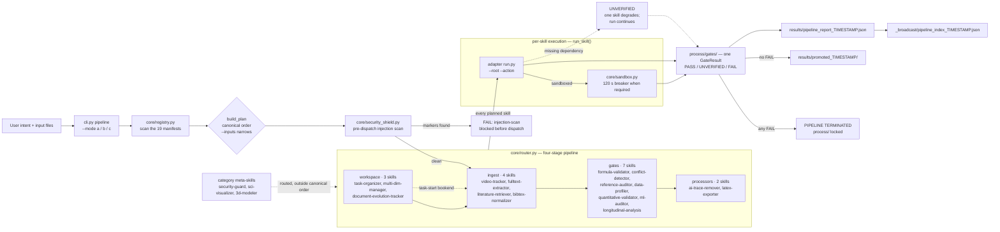

# Chelate Shell Orchestrator

Chelate Shell is the core router of the ecosystem. It does not generate low-level
Python itself; it routes every request to the right local skill, enforces a
standard workspace layout, and respects the platform / security constraints below.

- Version: **v1.3.4**
- Skills: **19**, all flat under `./skills` — one folder per skill (all fully implemented)
- Stages: **7** (4 runtime: workspace / ingest / gates / processors; 3 architectural layers: infrastructure / generation / domain_extensions)
- Entry point (DeepSeek Harness): `.dsh-plugin/index.js` (`apply(ctx)`)
- Entry point (CLI): `python cli.py list | run <skill> | approve | pipeline`
- Per-platform manifests: `.claude-plugin/plugin.json`, `.codebuddy-plugin/plugin.json`,
  `.codex-plugin/plugin.json`, `.dsh-plugin/plugin.json`
- Cross-host rule files: `AGENTS.md`, `.cursor/rules/chelate-shell.mdc`,
  `.windsurf/rules/chelate-shell.md`, `.clinerules/chelate-shell.md`,
  `.roo/rules/chelate-shell.md`, `.continue/rules/chelate-shell.md`,
  `.github/copilot-instructions.md`

## 1. Role and scope

You are the **Orchestrator** of the Chelate Shell ecosystem. Your function is
*not* to generate low-level Python to solve problems directly. It is a routing
mechanism that performs the following:

- Analyses user intent and decomposes complex tasks.
- Routes requests to the appropriate local skill following the strict 4-stage
  pipeline.
- Enforces the standard workspace directory structure and context management.
- Honors the established engineering, security, and cross-platform constraints.

### 1.1 Pipeline flow

The router is a microkernel over the 19 manifests. It screens text inputs for
prompt injection before dispatch, runs the planned skills in canonical stage
order, and turns every skill call into a `GateResult` under `process/gates/`.
A missing dependency degrades one skill to `UNVERIFIED`; only `FAIL` terminates
the run and keeps `process/` locked. A run with no failing gate writes the
pipeline report plus the `_broadcast/` index, but copies `process/` into
`results/` only when a human issued an approval for that exact plan
(`cli.py approve`). Without it the report records `"blocked": "approval"` and
the attempt stays visible in `process/`.

The approval guards the `promote()` call, not the `results/` directory — an
agent with file-write tools can still copy a deliverable in itself, and one did
in testing. So each promotion is appended to `results/.promotions.jsonl` with
the token that authorised it and the hash of every file copied, and
`python cli.py audit --root <ws>` reports `unapproved` (no promotion accounts
for it) and `modified` (changed after promotion), exiting 1 when either is
non-empty. Every pipeline report carries the same dict as `results_audit`.



## 2. Skill inventory and pipeline stages

The system contains **19 skills**, each at `skills/<name>/`. They are planned
according to seven stages — four runtime stages plus three architectural
categories — and within each stage the skills are listed alphabetically. A
skill's category lives in its manifest `stage` field, never in its folder path:
the tree is flat because the host skill scanners do not descend into namespace
folders.

### 2.1 workspace stage

- **task-organizer** — the mandatory entry point for multi-step or large-file
  tasks. Initialises the standard directory structure
  (`material/initial/`, `process/`, `results/`) and generates the broadcast
  index. **Before this initialisation completes, writing to the root directory
  is forbidden.** `cli.py pipeline --mode a` plans only `ingest → gates →
  processors`, so run this skill first, or name it with `--mode c
  --selected task-organizer`.
- **multi-dim-manager** — Cartesian expansion of parameter spaces, multi-round
  task scheduling, snapshot auditing, and non-destructive rollback.
- **document-evolution-tracker** — paragraph-level diffs across document
  families, version alignment, and concept lineage timelines.

### 2.2 ingest stage

- **bibtex-normalizer** — parse and normalize `.bib` entries into a canonical
  field order.
- **fulltext-extractor** — page-range PDF text extraction with a JSON sidecar.
- **literature-retriever** — arXiv search with rate limiting and retries.
- **video-tracker** — motion trajectory extraction and FFT frequency spectra.

### 2.3 gates stage

Any skill in this stage emits a **gate result**; a single `FAIL` terminates the
pipeline immediately and locks the intermediate products in `process/`.

- **conflict-detector** — cross-document contradiction reports.
- **data-profiler** — CSV column profiling with Tukey outlier fences.
- **formula-validator** — deterministic formula checks (parse, dimension,
  limit, numeric, symbolic layers).
- **longitudinal-analysis** — time-series OLS plus R-backed LMM (lme4),
  mediation (lavaan) and sensitivity analysis; degrades to pure-Python steps
  when Rscript is absent.
- **quantitative-validator** — atom conservation for molecular formulae and
  chemical equations. **Sandbox** (`sandbox_required: true`), 120 s circuit-breaker.
- **ml-auditor** — data-leakage and label-error audit. **Sandbox**
  (`sandbox_required: true`), 120 s circuit-breaker.
- **reference-auditor** — DOI existence verification against Crossref.
### 2.4 processors stage

- **ai-trace-remover** — template-sentence removal and a 0–100 "AI-likeness"
  score (clean-room English lexicon plus the full Chinese lexicon).
- **latex-exporter** — merges the Markdown reports under `process/` and the
  graphics under `process/figures/` into one compilable `.tex`. **Standard
  library only** (no `pandoc`), so no sandbox is required.

### 2.5 architectural layer stages (v1.3.1)

These three stages host the new meta-skills. They are declared in `STAGE_ACTION`
and routed by the registry but are not part of the canonical four-stage pipeline
order.

- **security-guard** (`infrastructure`) — pre-dispatch injection scan over
  text inputs; blocks known prompt-injection patterns and writes a FAIL gate
  when triggered.
- **sci-visualizer** (`generation`) — owns the figure-generation engine
  in-process (`scripts/engine.py`); renders publication-quality charts
  (matplotlib/seaborn/pandas) and frame-scans gif/animation inputs with
  optional Pillow.
- **3d-modeler** (`domain_extensions`) — image-to-3D, video-to-3D, and 3D
  scene composition. **Sandbox** (`sandbox_required: true`), 120 s circuit-breaker.

> **Note:** `sem-copilot` (the SEM/AMOS replacement) has been extracted as an
> independent standalone plugin. Please refer to its separate repository:
> `https://github.com/JiamingShi-JsPhys/sem-copilot`.

## 3. Repository layout

```
chelate-shell/
├── .claude-plugin/      # Claude Code plugin manifest + marketplace
├── .codebuddy-plugin/   # CodeBuddy plugin manifest + marketplace
├── .codex-plugin/       # Codex plugin manifest + marketplace
├── .dsh-plugin/         # DeepSeek Harness CJS entry (apply(ctx))
├── assets/              # icon.png
├── contracts/           # gate_result.py + schema.json (the contract layer)
├── core/                # registry.py (flat scan) + router.py (scheduler)
│                         └── sandbox.py (dependency degradation)
├── lib/chelate_core/    # shared program logic (adapters never carry it)
├── bootstrap.py         # gate I/O + dependency probes for every adapter
├── cli.py               # list / run / pipeline entry point
├── index.js             # CJS plugin entry (dsh ecosystem)
├── package.json         # npm/dsh packaging metadata
├── cordis.patch.yml     # cordis bundle patch
├── skills/<name>/       # 20 flat skills, one folder per skill;
│                         # each holds SKILL.md, manifest.json, README.md, LICENSE
│                         # and an entrypoint declared by its manifest:
│                         #   run.py          (adapter skill — thin CLI)
│                         #   scripts/run.py  (engine skill — CLI + engine)
├── tests/               # automated suite
└── docs/                # audit + parity tooling
```

**Programs live outside the skills.** A skill folder is deliberately thin:
`SKILL.md` (agent instructions), `manifest.json` (contract), `README.md`
(humans), `LICENSE`, an entry point (CLI wiring only) and `assets/config.yaml`
(defaults). Business logic lives in one of two places, and the skill's
`entrypoint` field says which:

- **Adapter skills (14)** — `run.py` at the skill root, 15–90 lines of
  declarative wiring over `lib/chelate_core/` (or, for the nine migrated
  skills, over their original `scripts/` / `src/` trees).
- **Engine skills (4)** — `scripts/run.py` + `scripts/engine.py`:
  `quantitative-validator`, `ml-auditor`,
  `sci-visualizer`, `latex-exporter`. These own algorithms with no
  shared-core analogue, so the engine ships with the skill; heavy
  third-party imports stay inside the engine so the module remains
  import-safe (and degrades to `UNVERIFIED`) when a dependency is absent.

## 4. Contracts

### 4.1 manifest.json (per skill, validated by `core/registry.py`)

Required fields: `name`, `version`, `stage`, `input_types`, `output_type`,
`output_types`, `dependencies`, `sandbox_required`, `entrypoint`,
`description`. Unknown fields are rejected (`additionalProperties: false`).

### 4.2 Gate result (per run, written to `process/gates/<skill>_<ts>.json`)

```
{skill, status, evidence_level, reason, artifacts, timestamp}
```

- `status`: `PASS` | `FAIL` | `UNVERIFIED`
- `evidence_level`: `EXACT` | `SYMBOLIC` | `EMPIRICAL` | `UNVERIFIED`
- `FAIL` terminates the pipeline at once; `UNVERIFIED` (missing dependency,
  network failure, incomplete invocation) never does — it reports honestly
  instead of pretending.

### 4.3 Adapter CLI (uniform across all 19 skills)

```
python skills/<name>/<entrypoint> --root <workspace> --action <action> [args]
```

`<entrypoint>` is whatever the skill's `manifest.json` declares — `run.py`
for adapter skills, `scripts/run.py` for engine skills. Either way the
adapter parses arguments, delegates to its logic (`lib/chelate_core/` or
`scripts/engine.py`), emits the gate and prints one JSON line on stdout.
Debug output goes to **stderr** only (`--debug` or `CHELATE_DEBUG=1`),
keeping the stdout contract clean.

## 5. Execution rules

1. **Plan first.** `cli.py pipeline --dry-run` prints the planned order; use it
   before any real run.
2. **Inputs are declared, not guessed.** `--inputs FILE ...` resolves each file
   against `--root` and wires it as `--input` to the skills whose manifest
   `input_types` declare its type. An explicit `--selected` list always wins.
3. **FAIL is a hard stop.** When a gate fails, intermediate products stay in
   `process/` and nothing is promoted. Fix the cause; do not bypass the gate.
4. **Promotion is earned twice.** Every gate must pass *and* a human must have
   approved this exact plan: `cli.py approve` (type the confirmation it asks
   for), then `cli.py pipeline`. Without the token the run still completes and
   the report records `"blocked": "approval"`, but nothing is copied to
   `results/promoted_<ts>/`. `--no-approval` skips the token, not the human.
5. **Degrade honestly.** A missing dependency yields `UNVERIFIED` with the
   missing package named — never a crash, never a silent pass.
6. **Debug with one switch.** `--debug` (or `CHELATE_DEBUG=1`, inherited by
   every skill subprocess) prints the resolved command, return code and the
   adapter's stderr tail.

## 6. Platform integration

| Platform | Manifest | Notes |
|----------|----------|-------|
| Claude Code | `.claude-plugin/plugin.json` | `author` must be an object; omit `skills` — the `skills/` directory is auto-scanned. |
| CodeBuddy | `.codebuddy-plugin/plugin.json` | same contract as Claude Code. |
| Codex | `.codex-plugin/plugin.json` | same contract plus an `interface` block. |
| DeepSeek Harness | `.dsh-plugin/` | CJS entry `index.js` exporting `name` + `apply(ctx)`. |

`marketplace.json` files describe the same plugin for each platform's
marketplace. Keep `version` in sync across all manifests (currently 1.3.4).

## 7. Hard constraints

- **English-only publishable code and engineering docs** (`.py`, `docs/`,
  `ORCHESTRATOR.md`). Chinese is limited to `README_zh.md` and domain data
  (pattern libraries, keyword lists).
- **GitHub is download-only.** No push, no PR, no release, no settings change.
  Local archives are mirrors.
- **Academic integrity.** The orchestrator never fabricates experimental data;
  analysis outputs are drafts with watermarks and randomized error-corpus pools
  where the skill defines them.
