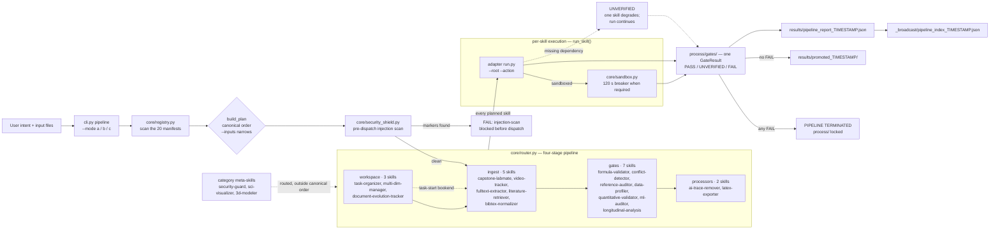

# Chelate Shell

> **A deterministic orchestrator for research and engineering workflows, with 20 skills included.**
>
> You do not need to supply the skills yourself. Twenty research and engineering skills ship with the repository: formula validation (five check layers over SymPy plus a pint unit cross-check), atom conservation with RDKit, mixed models and mediation analysis through R, video trajectory extraction with OpenCV, publication-grade charts, PDF text extraction, and Markdown → compilable LaTeX export. All 20 are part of the install and run in the pipeline as shipped.
>
> `core/router.py` runs them in a fixed stage order, screens text inputs for prompt injection before dispatch, writes a typed `GateResult` for every call, and terminates the pipeline on the first `FAIL`.

**English** · [简体中文](README_zh.md)

**Version:** 1.3.0 | **Skills:** 20 
---

## Security & Open Source Statement

> **Disclaimer**: This repository contains auxiliary tools developed by the author to automate research workflows. It is not a peer-reviewed academic project. Some boilerplate or utility scripts may have been generated with the assistance of AI, and have been integrated with high-level review and modifications by the author. The author assumes no responsibility for any third-party code issues, but commits to promptly addressing any valid claims.
>
> This tool **will never do the experiment for you**. Data must be collected manually by students in the lab; AI is absolutely physically isolated during the in-lab stage. Generated reports are merely "data-analysis drafts", and final academic responsibility lies with the user and their institution.

---

## Why Chelate Shell?

In the current AI ecosystem, individual skills excel at solving isolated problems: validating formulas, tracking videos, or organizing files. However, when an Agent faces a complex task, it often struggles to determine **which skill to invoke, in what order, and where to place the outputs**. Scattered, stateless skill calls lead to context pollution, file-version confusion, and untrustworthy AI hallucination.

Chelate Shell addresses this in two parts, and both are part of the same repository.

**The 20 skills implement their algorithms directly.** They are not prompt templates. `formula-validator` runs five check layers over SymPy and cross-checks units with pint. `quantitative-validator` balances chemical equations through RDKit. `longitudinal-analysis` calls lme4 and lavaan in R. `video-tracker` performs CSRT tracking in OpenCV and computes an FFT of the trajectory. `ml-auditor` checks labelled datasets for data leakage and label errors with scikit-learn. `sci-visualizer` renders publication-grade charts with matplotlib and seaborn. `fulltext-extractor` extracts page ranges from PDFs, and `latex-exporter` assembles the Markdown reports into a compilable `.tex` using the standard library only. Each one is wired into the pipeline and covered by the test suite.

**The orchestrator supplies the guarantees an individual skill cannot provide for itself.** `core/router.py` decomposes the request, enforces the standard four-zone workspace, and routes work in a deterministic stage order, so the same inputs always produce the same plan. It also writes a typed gate for every call, stops the pipeline on the first `FAIL`, reports an explicit `UNVERIFIED` when a dependency is missing, and maintains the `_broadcast/` index that lets a later session read one summary instead of every original.

---

## How a run flows

`core/router.py` is a microkernel: it reads the 20 `manifest.json` files, builds a plan in the canonical stage order, screens text inputs for prompt injection **before** dispatching anything, and then calls each skill's adapter. Every call writes a `GateResult` to `process/gates/` — `PASS`, `UNVERIFIED`, or `FAIL`.

A missing dependency degrades one skill to `UNVERIFIED` and the run continues. A single `FAIL` is terminal: the pipeline stops on the spot and leaves the intermediate products locked in `process/`. When no gate fails, `process/` is promoted into `results/`, and the run is summarised in a typed pipeline report plus the `_broadcast/` index that a later session reads before opening any original.



Three things the diagram makes explicit:

- **The automatic pipeline is `ingest → gates → processors`.** `workspace` (task-organizer) is the bookend at task start, entered before the pipeline or through `--selected`; `--mode a` does not schedule it.
- **`UNVERIFIED` is not a failure.** It means a skill could not assert a verdict — a missing optional dependency, an input the caller has not supplied yet — and the rest of the run keeps going.
- **Only `FAIL` is terminal.** It locks `process/` exactly where it stopped, so the intermediate products stay auditable but are never mistaken for results.

---

## Installation

Three ways in. Plugin hosts install Chelate Shell as **one plugin** — the only form that keeps microkernel auto-routing intact. Hosts without a plugin channel take it as a **rule file**, and one script writes every rule file for you. The third way hands the whole job to an AI.

### Method 1: install from the plugin marketplace by URL

Every host below has its own plugin marketplace. Register this repository's Git URL, then install the plugin it lists (registering the URL twice is harmless — the second call reports it is already known).

```bash
https://github.com/JiamingShi-JsPhys/chelate-shell
```

### Method 2: install with commands

**Claude Code** — from your shell (v2.1.292+), marketplace and install in one step:

```bash
claude plugin install chelate-shell --marketplace https://github.com/JiamingShi-JsPhys/chelate-shell.git
```

**Claude Code** — from inside a session (v2.1.275+), add the marketplace from the URL first, pinned to the release tag:

```text
/plugin marketplace add https://github.com/JiamingShi-JsPhys/chelate-shell.git#v1.3.0
```

Then install the entry it lists:

```text
/plugin install chelate-shell@chelate-shell-marketplace
```

**Codex** — register the URL as a Git marketplace; `--ref` pins the release tag, and an SSH URL or a local path works in place of the HTTPS one:

```bash
codex plugin marketplace add https://github.com/JiamingShi-JsPhys/chelate-shell.git --ref v1.3.0
```

**Codex** — install the plugin from that marketplace:

```bash
codex plugin add chelate-shell@chelate-shell-marketplace
```

**dsh (DeepSeek Harness)** — installs from the same repository URL straight into a profile:

```bash
dsh plugin --profile web add github:JiamingShi-JsPhys/chelate-shell#v1.3.0
```

**CodeBuddy** — add the URL as a Git marketplace:

```text
/plugin marketplace add https://github.com/JiamingShi-JsPhys/chelate-shell.git#v1.3.0
```

Then install the entry it lists:

```text
/plugin install chelate-shell@chelate-shell-marketplace
```

Cursor, Windsurf, Cline's IDE extension, Continue, Roo Code, GitHub Copilot and opencode each read a rule file from their own location, and none of them accepts this repository as a plugin — Cline's `cline plugin install` takes only JS/TS plugin packages, Cursor's plugin format is a different bundle, and `opencode plugin <module>` installs npm modules. **No vendor ships an installer that understands another vendor's rule file**, so this repository ships one:

```bash
git clone https://github.com/JiamingShi-JsPhys/chelate-shell.git && python chelate-shell/install.py --project <project> --global
```

That single command writes every rule file at once:

- `--project <project>` covers the project-scoped files — Cursor, Windsurf, Cline, Continue, Roo Code, GitHub Copilot, and the generic `AGENTS.md` that Codex, Cursor, Copilot agents and opencode all read.
- `--global` covers the user-scoped files — `~/.config/opencode/AGENTS.md`, `$CODEX_HOME/AGENTS.md` (default `~/.codex/AGENTS.md`), and `~/.claude/CLAUDE.md` when `~/.claude` already exists — and skips any host this machine does not have.

Re-running it is safe: identical files report `unchanged`, and a rule file that has drifted is left alone unless you pass `--force`.

List every destination without writing anything:

```bash
python chelate-shell/install.py --list
```

Preview the run:

```bash
python chelate-shell/install.py --project <project> --global --dry-run
```

Install for one host only:

```bash
python chelate-shell/install.py --project <project> --only cursor,windsurf
```

Keep the cloned repository somewhere the agent can reach: every rule file names `cli.py`, `ORCHESTRATOR.md` and `task-organizer`, so the host agent enters the same pipeline as a plugin host. The rule file describes *how to call* the suite — it does not vendor the code.

**opencode without copying** — opencode can also read the rule file in place through `opencode.json`'s `instructions` array, which needs no copy and can be committed for a whole team:

```json
{
  "$schema": "https://opencode.ai/config.json",
  "instructions": ["../chelate-shell/AGENTS.md"]
}
```

**Manual alternative** — if you would rather not run the script, copy the file yourself to the destination the script would have used:

```text
<clone>/AGENTS.md  →  <project>/AGENTS.md
```

### Method 3: let your AI install it

```bash
Please visit the GitHub repository `https://github.com/JiamingShi-JsPhys/chelate-shell` and clone it, then run `python install.py --project . --global`. If your host has a plugin system, install it as a single plugin instead; the script covers the hosts that read rule files.
```

> **Warning**: when an AI performs the installation it will very likely scatter the individual skills from `skills/` flat into the platform's global skill directory. That breaks Chelate Shell's microkernel auto-routing architecture and degrades it into 20 loose skills. Use Method 1 if you need the full plugin orchestration.

## Quick start

All commands run from the repository root — **never hard-code absolute paths**.

List the routing table:

```bash
python cli.py list
```

Run one skill directly:

```bash
python cli.py run reference-auditor --root /path/to/workspace --action audit --input draft.md
```

Dry-run a pipeline to see the planned execution order:

```bash
python cli.py pipeline --root /path/to/workspace --mode a --input-kind pdf --dry-run
```

Run the full pipeline (ingest → gates → processors):

```bash
python cli.py pipeline --root /path/to/workspace --mode a --input-kind pdf
```

Run gates only, with per-skill arguments:

```bash
python cli.py pipeline --root /path/to/workspace --mode c --selected reference-auditor --skill-arg "reference-auditor:--input draft.md"
```

Initialise a complex-task workspace:

```bash
python skills/task-organizer/run.py --root <workspace> --action init
```

Rebuild the context-compression index:

```bash
python skills/task-organizer/run.py --root <workspace> --action broadcast
```

Validate a physics formula deterministically (bypass mode):

```bash
python skills/formula-validator/run.py --root <workspace> --action validate -- --expr "F = m*a" --units F=N --units m=kg --units a=m/s**2
```

Audit the DOIs in a draft (a fake DOI fails the gate and stops the pipeline):

```bash
python skills/reference-auditor/run.py --root <workspace> --action audit --input draft.md
```

Remove AI traces from a draft:

```bash
python skills/ai-trace-remover/run.py --root <workspace> --action scan -- <file>
```

Screen a file for prompt injection and dangerous call sites:

```bash
python skills/security-guard/run.py --root <workspace> --action gate --input draft.md
```

Declare the run's input files, each wired as `--input` to the plan:

```bash
python cli.py pipeline --root ./test_workspace --inputs draft.md data.csv
```

Debug one skill (the flag may sit before or after the skill name):

```bash
python cli.py run data-profiler --root /path/to/workspace --action profile --input data.csv --debug
```

Debug a whole pipeline through the environment variable:

```bash
CHELATE_DEBUG=1 python cli.py pipeline --root /path/to/workspace --mode c --selected reference-auditor
```

Pipeline modes: `a` auto (ingest → gates → processors), `b` extract-only, `c` gates-only. `--inputs` narrows the plan to the skills that can consume the declared files (an explicit `--selected` list always wins); a file whose extension declares no manifest type is reported as an `[INPUT]` warning and wires to nothing. Each declared file is resolved against `--root` (relative paths anchor at the workspace root, absolute paths are used as-is); a missing file fails fast with exit code 2 **before any skill runs**.

## Requirements

Python 3.10+ and nothing else to start: the microkernel and most skills run on the standard library alone. A handful of data and network skills additionally want common third-party packages (numpy, pandas, sympy, rdkit, matplotlib, requests and friends); each skill's `manifest.json` declares exactly what it needs, and `core/sandbox.py` checks that at run time. A missing package never crashes the pipeline — that one skill degrades to an `UNVERIFIED` gate with a hint and the rest keeps running. No third-party code is vendored; every library stays under its own permissive licence. The full per-skill matrix lives in [docs/DEPENDENCIES.md](docs/DEPENDENCIES.md).

## Repository layout

```text
chelate-shell/
├── .claude-plugin/                   # Claude Code plugin manifest + marketplace
├── .clinerules/                      # Cline rule file
├── .codebuddy-plugin/                # CodeBuddy plugin manifest + marketplace
├── .codex-plugin/                    # Codex plugin manifest + marketplace
├── .continue/rules/                  # Continue rule directory
├── .cursor/rules/                    # Cursor rule file (.mdc)
├── .dsh-plugin/                      # DeepSeek Harness CJS entry (apply(ctx))
├── .github/                          # GitHub Copilot instruction file
├── .gitignore
├── .roo/rules/                       # Roo Code rule directory
├── .windsurf/rules/                  # Windsurf rule file
├── agents/                           # sub-agent role definitions
│   ├── spatial_agent.md              # mesh/3D role (3d-modeler)
│   └── visual_agent.md               # figure/visualisation role (sci-visualizer + latex-exporter)
├── AGENTS.md                         # generic agent contract (Codex / Cursor / Copilot / opencode)
├── assets/                           # icon.png (shared by the plugin manifests)
├── bootstrap.py                      # shared import + gate-write helper for every run.py
├── CHANGELOG.md                      # release notes
├── cli.py                            # CLI entry: list / run / pipeline
├── commands/                         # slash commands
│   ├── figure.md                     # /figure — chart from a CSV or JSON dataset
│   └── model3d.md                    # /model3d — OBJ mesh generate / merge / audit
├── contracts/                        # global contracts
│   ├── __init__.py
│   ├── gate_result.py                # {skill, status, evidence_level, reason, artifacts}
│   └── schema.json                   # manifest.json validation spec
├── cordis.patch.yml                  # cordis bundle patch
├── core/                             # microkernel
│   ├── __init__.py
│   ├── registry.py                   # scans skills/ into a routing table
│   ├── router.py                     # dispatcher: manifest-driven pipeline
│   ├── sandbox.py                    # dependency resolution / 120-second circuit-breaker
│   ├── security_shield.py            # anti-injection text scan + AST dangerous-call scan
│   └── subagent_manager.py           # sub-agent role registry
├── docs/                             # design notes, audit reports, file-function map
├── index.js                          # CJS plugin entry (dsh ecosystem)
├── install.py                        # one-command rule-file installer (see Installation)
├── lib/chelate_core/                 # shared core library (logic lives here)
│   ├── __init__.py
│   ├── adapter.py                    # thin-adapter toolkit: argparse, gate emission, legacy runner
│   ├── arxiv_search.py               # arXiv search core
│   ├── bibtex_norm.py                # BibTeX parse / dedupe / normalize core
│   ├── csv_profile.py                # CSV profiling core (pandas)
│   ├── debug.py                      # [chelate:debug] switch shared by every layer
│   ├── doi_audit.py                  # DOI extraction + Crossref verification core
│   ├── formula_merge.py              # legacy D1-D5 + pint verdict merge policy
│   ├── paths.py                      # path resolution
│   ├── pdf_text.py                   # PDF extraction core (pdfminer.six / pypdf)
│   └── yamlmini.py                   # assets/config.yaml loader
├── LICENSE
├── ORCHESTRATOR.md                   # agent-facing routing contract (v1.3.0)
├── package.json                      # npm/dsh packaging metadata
├── README.md
├── README_zh.md
├── skills/                           # 20 skills, all flat — one folder per skill
│   ├── 3d-modeler/                   # [domain_extensions] pure-Python OBJ mesh generate /
│   │                                 # merge / audit with mesh QC; sandboxed
│   ├── ai-trace-remover/             # [processors] template-sentence removal and a
│   │                                 # 0–100 "AI-likeness" score (EN + ZH lexicons)
│   ├── bibtex-normalizer/            # [ingest]    .bib parsing, dedupe, normalized output
│   ├── capstone-labmate/             # [ingest]    PASCO Capstone .cap binary parsing,
│   │                                 # CSV/JSON conversion, watermarked drafts
│   ├── conflict-detector/            # [gates]     cross-document contradiction engine
│   │                                 # with regex number extraction
│   ├── data-profiler/                # [gates]     pandas CSV profiling: row counts,
│   │                                 # missing values, 1.5·IQR outliers, duplicates, constant columns
│   ├── document-evolution-tracker/   # [workspace] paragraph-level diff across
│   │                                 # document versions, concept-lineage tracking
│   ├── formula-validator/            # [gates]     SymPy D1–D5 layers (dimensional analysis,
│   │                                 # limit enumeration, numeric sampling, symbolic proof)
│   │                                 # + pint unit cross-check
│   ├── fulltext-extractor/           # [ingest]    pdfminer.six text extraction into process/
│   │                                 # (pypdf fallback)
│   ├── latex-exporter/               # [processors] merges process/ Markdown + process/figures/
│   │                                 # into one compilable .tex
│   ├── literature-retriever/         # [ingest]    arXiv keyword search to JSON
│   ├── longitudinal-analysis/        # [gates]     time-series OLS plus R-backed LMM (lme4),
│   │                                 # mediation (lavaan), sensitivity analysis;
│   │                                 # pure-Python steps without Rscript
│   ├── ml-auditor/                   # [gates]     data-leakage and label-error audit with
│   │                                 # scikit-learn (cleanlab optional); sandboxed
│   ├── multi-dim-manager/            # [workspace] parameter-space expansion, SHA-256 snapshots,
│   │                                 # hash audit logs, rollback to any past round
│   ├── quantitative-validator/       # [gates]     atom conservation for molecular formulae and
│   │                                 # chemical equations (Hill-notation grammar + rdkit
│   │                                 # cross-check); sandboxed
│   ├── reference-auditor/            # [gates]     DOI extraction + Crossref verification;
│   │                                 # a fake DOI fails the gate
│   ├── sci-visualizer/               # [generation] publication-quality charts (matplotlib +
│   │                                 # seaborn + pandas), incl. AMOS-style SEM path renderer,
│   │                                 # plus gif frame scan
│   ├── security-guard/               # [infrastructure] anti-injection text scan +
│   │                                 # AST scan for dangerous call sites
│   ├── task-organizer/               # [workspace] four-zone workspace init, file organization
│   │                                 # (C1–C8 validation, dedupe, snapshots, undo/redo),
│   │                                 # _broadcast/INDEX.md context index
│   └── video-tracker/                # [ingest]    OpenCV coordinate extraction (CSRT/Template),
│                                     # FFT spectrum, physics probes
├── tests/                            # automated test suite (357 tests)
└── THIRD_PARTY_LICENSES.txt          # upstream licence inventory
```

---

## Tests

```bash
python -m pytest tests/ -q
```

That is 357 tests (347 passed, 10 skipped — dependency gates such as `rdkit` and fixture-gated cases). The suite covers the gate contract, manifest schema validation, flat-layout enforcement (a manifest must sit exactly one level under `skills/`), pipeline planning and FAIL termination, the migration guard, the legacy D1–D5 and FFT/physics probes, the five skills added in v1.1.x, workspace input-path resolution, `--inputs` auto-wiring, the unified debug layer, the manifest-contract suite (plugin manifests for all four host platforms, plus SKILL.md frontmatter agreement), the rule-file adapters for the plugin-less hosts, the security shield, the four heavy engine skills' real logic and `UNVERIFIED` degradation, and the repo-consistency guard: every skill's docs, manifest, entrypoint, `LICENSE` and declared dependencies stay in agreement.

## Known limitations

Honest edge cases — read before relying on any output:

- **Automatic ROI detection can fail**: `video-tracker` may fail on low-contrast video; every run must be checked against the reference. Marked *experimental / unstable*.
- **Formula checking is not a mathematical proof**: `formula-validator` is a deterministic verdict. An `unknown` return means one check "abstained" — a legitimate state that must never be reinterpreted as a pass.
- **Longitudinal analysis depends on R**: some advanced statistical steps of `longitudinal-analysis` run through R scripts; if `Rscript` is absent those steps are skipped and logged — **never hand-write Python code to replace skipped R steps**.
- **Version tracking is structural, not semantic**: `document-evolution-tracker` diffs by block alignment; a concept counts as "present" only on a literal match.
- **DOI audit verifies existence only**: `reference-auditor` confirms a DOI exists in Crossref, not that it is the paper you meant to cite — citation correctness remains the author's responsibility.
- **The injection scan is a screen, not a sandbox**: `security-guard` flags known markers and dangerous call sites; it cannot prove a file is safe.
- **Data profiling never cleans data**: `data-profiler` only reports missing values / outliers / duplicate rows; it never modifies input files.
- **Determinism covers the scheduling layer only**: the router guarantees the same input routes to the same skill, but it cannot make a non-deterministic underlying algorithm deterministic.

## Report issues

**Regular bugs / feature requests**: file them on the repository's [Issues](https://github.com/JiamingShi-JsPhys/chelate-shell/issues) page. Include reproduction steps, expected behavior, actual behavior, and the environment (operating system, Python version).

**Security vulnerabilities (this category only)**: do **not** use the public Issues page. Email `jiamingshi_git@outlook.com` instead.

- **Subject**: must carry the prefix `_report` plus the specific product or skill name and a short summary.
  - Example: `report_chelate-shell: path traversal can read outside the task folder`
- **Body**: must include detailed reproduction steps and the environment.
- For serious "file loss or corruption" reports, attach the before/after directory trees (`tree` output) and the generated `verification_report.md`.

*Contributors who file clear, reproducible issues or pull requests will be credited in the next release's notes.*

## Trademarks

"PASCO" and "Capstone" are registered trademarks of PASCO Scientific. The `capstone-labmate` skill is an independent, third-party interoperability and educational-assistance tool. It is not affiliated with, endorsed by, or sponsored by PASCO Scientific. All `.cap` parsing runs locally; users are responsible for complying with their institution's academic-integrity policy.

## License

MIT. See [LICENSE](LICENSE). Each skill directory also carries its own `LICENSE` file with the same terms.

**Author & Maintainer**: Jiaming Shi (Westlake University)
