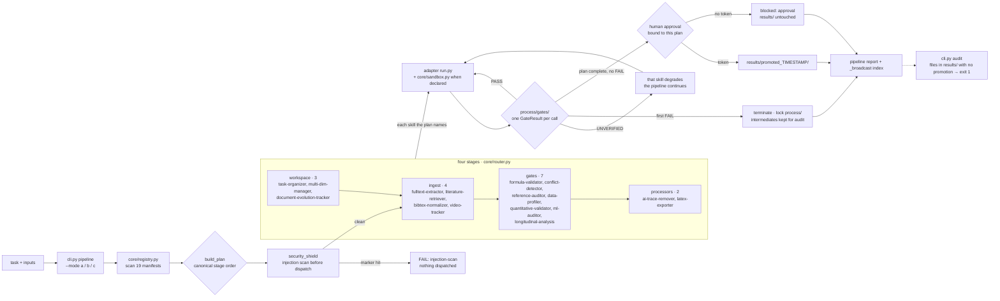

# Chelate Shell

**Nineteen research skills routed as one deterministic pipeline — and it stops before the one step that cannot be undone.**

Each skill solves a single problem. The hard part is what runs first, and where the output lands — Chelate Shell puts the skills, the stage order and the gates in one repository.

**English** · [简体中文](README_zh.md)

**Version:** 1.3.4 | **License:** MIT | **Python:** 3.10+ | **Skills:** 19

> Research assistance only. Read [Safety and licensing](#safety-and-licensing) before relying on any output.

---

## Contents

**Start**

- [Why Chelate Shell](#why-chelate-shell)
- [Install and download](#install-and-download)
- [Quick start](#quick-start)
- [Things you can just ask](#things-you-can-just-ask)

**Going deeper**

- [How a run flows](#how-a-run-flows)
- [Repository layout](#repository-layout)
- [Full reference](#full-reference)
- [Security boundary](#security-boundary)

**Other**

- [Requirements](#requirements)
- [Tests](#tests)
- [Safety and licensing](#safety-and-licensing)
- [Known limitations](#known-limitations)
- [Issues and feedback](#issues-and-feedback)
- [Acknowledgements](#acknowledgements)
- [Trademarks](#trademarks)
- [License and author](#license-and-author)

---

## Why Chelate Shell

Every skill in today's AI ecosystem solves one problem: check a formula, track a video, tidy up files. What an agent still has to decide on a complex task is **which skill to call, in what order, and where its output belongs** — and loose, stateless calls produce context pollution, muddled file versions and confident nonsense. Chelate Shell answers that at two levels, both in the same repository.

- **The 19 skills implement their algorithms directly, not as prompt templates.** `formula-validator` runs five check layers over SymPy and cross-checks units with pint; `quantitative-validator` balances chemical equations through RDKit; `longitudinal-analysis` calls lme4 and lavaan in R; `video-tracker` performs CSRT tracking in OpenCV and computes an FFT of the trajectory; `ml-auditor` checks labelled datasets for leakage and label errors with scikit-learn; `sci-visualizer` renders publication-grade charts; `fulltext-extractor` pulls page ranges out of PDFs; `latex-exporter` assembles the Markdown reports into a compilable `.tex` using the standard library only.
- **The orchestrator guarantees what a lone skill cannot.** `core/router.py` breaks the task down, enforces the four-zone workspace, and routes in a deterministic stage order, so the same input always produces the same plan. Every call writes a typed gate, the first `FAIL` stops the pipeline, and a missing dependency is reported as `UNVERIFIED` rather than silently skipped.
- **The one irreversible step needs a person to say yes.** Promoting `process/` into `results/` requires an approval a human issued for that exact plan; the signing key lives outside the workspace, so an agent cannot mint its own. Without one the run still completes, but nothing is written to `results/` and the process exits non-zero.

---

## Install and download

Install this repository as **one plugin**. Do not let an AI copy the folders under `skills/` into a global skill directory — microkernel auto-routing depends on the repository layout (`core/`, `lib/`, and one flat folder per skill).

**Most people take method one: let an AI install it.** Hosts with a plugin marketplace take method two; a terminal install, or several hosts at once, takes method three.

### Method one: let an AI install it

```bash
Visit the GitHub repository `https://github.com/JiamingShi-JsPhys/chelate-shell`, clone it, and run `python install.py --project . --global`. If your host has a plugin system, install the whole thing as a single plugin instead; that script covers the hosts that read rule files.
```

### Method two: install from a marketplace URL

```text
/plugin marketplace add https://github.com/JiamingShi-JsPhys/chelate-shell.git#v1.3.4
/plugin install chelate-shell@chelate-shell-marketplace
```

`#v1.3.4` pins the install to this release; drop it to follow the default branch. Registering the same URL twice is harmless — the second attempt reports that it already exists.

### Method three: install with commands

Claude Code, Codex, dsh and CodeBuddy install with a one-line plugin command; Cursor, Windsurf, Cline, Continue, Roo Code, GitHub Copilot and opencode read rule files, and one script writes all of them. Every command, every flag and the optional dependencies are on one page: **[docs/INSTALL_COMMANDS.md](docs/INSTALL_COMMANDS.md)**.

### Keeping an installed copy current

A host installs the plugin into a cache of its own, so the copy that actually runs is frozen at the moment of installation — a fixed bug keeps running until that cache is refreshed. Two commands close the gap:

```bash
python cli.py update            # does this copy still match main?
python cli.py update --apply    # run each host's own update command
```

`update` compares the files this copy is running with `main` (line endings aside, because version numbers do not move during a release window) and names the ones that differ. `--apply` runs `zcode plugins …` or `claude plugin update` for every host that actually has the plugin installed and reports each step. Both are best-effort: an offline machine is "unknown", not an error. `cli.py pipeline` and `cli.py audit` print one stderr line when the copy has drifted, checked at most once a day and cached; `CHELATE_UPDATE_OFF=1` silences it.

---

## Quick start

### From the chat box

Once the plugin is installed you do not leave the chat: type `/` and pick a skill. No terminal, no absolute paths — the workspace is the folder you are already working in. All 19 skills live under the `chelate-shell` namespace:

```text
/chelate-shell:task-organizer      turn this folder into a task workspace
/chelate-shell:formula-validator   check F = m*a with F=N, m=kg, a=m/s^2
/chelate-shell:reference-auditor   verify every DOI in draft.md against Crossref
/chelate-shell:security-guard      screen draft.md for prompt injection
/chelate-shell:data-profiler       profile data.csv
```

Say what you need after the name; the skill picks the action and writes a gate result. A fabricated DOI is not a gentle warning — it makes the gate `FAIL` and stops the pipeline.

### Two commands that wrap the heavier engines

| Command | Does |
|---|---|
| `/chelate-shell:figure` | Chart a CSV or JSON dataset (bar / line / scatter / box) into `process/figures/`, as a vector PDF and a raster PNG |
| `/chelate-shell:model3d` | Generate a Wavefront `.obj` from a JSON spec, or audit and merge an existing mesh, into `process/models/` |

```text
/chelate-shell:figure data.csv — scatter of voltage against time
/chelate-shell:model3d spec.json
```

Both run inside the sandbox with a 120-second fuse: bad input degrades to `UNVERIFIED` instead of wedging the pipeline.

### Two subagents registered with the plugin

| Subagent | Use it for | Skills it may call |
|---|---|---|
| `spatial_agent` | 3D work — image to 3D, video to 3D, scene composition, mesh QA | 3d-modeler, sci-visualizer, security-guard |
| `visual_agent` | Publication visuals — 2D charts, diagrams, gif frames, figure QA, LaTeX export | sci-visualizer, latex-exporter, security-guard |

The host routes matching work to them automatically, or you can name one. Each is constrained by a skill whitelist, a writable-path whitelist (`assets/`, `process/`, `results/`) and a step budget, so it cannot wander outside its role.

### From a terminal

The same operations run headless, for CI and scripts:

```bash
python cli.py list                                           # the 19 skills
python cli.py run task-organizer --root <ws> --action init   # make a workspace
python cli.py run data-profiler --root <ws> --input data.csv # run one skill
python cli.py pipeline --root <ws> --mode a                  # run the pipeline
```

The `a` / `b` / `c` pipeline modes, every flag and the debug switches are in [ORCHESTRATOR.md](ORCHESTRATOR.md) §5.

### What a run looks like

```text
> /chelate-shell:formula-validator   v = d/t    units: v=m, d=m, t=s

FAIL · SYMBOLIC
pint unit mismatch — LHS [length], RHS [length]/[time]
gate    → process/gates/formula-validator_20261112T130046Z.json
report  → process/reports/equation-4c9b2ce5-20261112-210045.md
```

A wrong dimension is not a reminder: it is a failed gate, a report on disk, and a pipeline that stopped.

---

## Things you can just ask

| Say it your way | Routes to | You get back |
|---|---|---|
| "Check `F = m*a` with F=N, m=kg, a=m/s²" | `formula-validator` | PASS / FAIL from five check layers, plus a Markdown report |
| "Verify every DOI in draft.md" | `reference-auditor` | each one checked against Crossref; a fake DOI fails the gate |
| "Do these two drafts agree?" | `conflict-detector` | every contradiction, with a severity |
| "Profile data.csv" | `data-profiler` | rows, missing values, 1.5·IQR outliers, duplicate rows |
| "Does this labelled dataset leak?" | `ml-auditor` | a leakage and label-error verdict, via scikit-learn |
| "Chart voltage against time" | `sci-visualizer` | vector PDF plus PNG in `process/figures/` |
| "Extract pages 3–7 of these PDFs" | `fulltext-extractor` | plain text plus a JSON sidecar in `process/` |
| "Find recent papers on X" | `literature-retriever` | arXiv metadata, stored as JSON |
| "Track the ball in this video" | `video-tracker` | coordinates, an FFT spectrum, physics-consistency probes |
| "Assemble my report into LaTeX" | `latex-exporter` | one `.tex` that compiles |
| "Generate this mesh and check it" | `3d-modeler` | an OBJ plus winding / degenerate-face / bounding-box audit |
| "Is this text trying to inject instructions?" | `security-guard` | injection markers and dangerous call sites |

All 19 skills and what each one actually computes: [repository layout](#repository-layout) and [docs/REFERENCE.md](docs/REFERENCE.md).

---

## How a run flows

`core/router.py` reads the 19 manifests, builds a plan in the canonical stage order, screens text inputs for prompt injection before dispatch, then calls each skill adapter.

| Stage | Does |
|---|---|
| `workspace` | `task-organizer` creates `material/initial/`, `process/`, `results/` |
| `ingest` | normalises inputs into `process/` |
| `gates` | every gate writes a result; the first `FAIL` terminates the pipeline and locks `process/` |
| `processors` | clean, transform and export into `results/` |

Every call writes a `GateResult`: `PASS` continues, `UNVERIFIED` degrades only that skill and the pipeline continues, and the first `FAIL` locks `process/` and stops. That lock **survives the run**: while the newest gate for a skill is `FAIL`, promotion is refused, and a later, narrower run cannot route around the failure it did not re-run.

Promoting `process/` into `results/` is the one irreversible step, so it needs an approval a human issued for that exact plan:

```bash
python cli.py approve  --root <ws> --mode a     # type the confirmation phrase
python cli.py pipeline --root <ws> --mode a     # promote with that approval
```

The approval is bound to the action, the resolved workspace, the mode and selected skills, the SHA-256 of every input file, and a 15-minute expiry; the signing key lives outside the workspace, so an agent cannot mint its own. Without one the run still completes — the attempt stays visible in `process/` — but nothing is written to `results/` and the process exits non-zero.

The gate guards `promote()`, not the directory: an agent holding a file-writing tool can still copy its own file into `results/`, and in a measured session one did. So every promotion is recorded in `results/.promotions.jsonl` (the token that authorised it, the hash of every file it copied), and `python cli.py audit --root <ws>` names every file in `results/` that no promotion accounts for, exiting 1; each pipeline report carries the same `results_audit`.



---

## Repository layout

`core/` is the microkernel, `lib/chelate_core/` holds the shared logic every adapter imports, `skills/` has one folder per skill (flat — host scanners do not descend into namespace folders), and each host's plugin manifest or rule file gets its own dot-directory.

```text
chelate-shell/
├── cli.py                 # list / run / pipeline / approve / audit / update
├── core/                  # router, approval, sandbox, security_shield, registry
├── lib/chelate_core/      # shared logic (paths, DOI, BibTeX, debug layer)
├── skills/                # 19 skills, one flat folder each
├── agents/                # subagents registered with the plugin
├── commands/              # slash commands (figure / model3d / trace / brainstorm)
├── docs/                  # architecture, reference, safety, testing, dependencies
└── tests/                 # root suite + the adversarial cases
```

Per-directory detail, and what each of the 19 skills computes: **[docs/REFERENCE.md](docs/REFERENCE.md)**.

## Full reference

Record shapes, every command and flag, exit codes, per-skill input types and dependencies, and directory detail live in **[docs/REFERENCE.md](docs/REFERENCE.md)**, so this page stays a quick start. The ones you meet most:

| Exit code | Means |
|---|---|
| `0` | the plan completed; promoted to `results/` when an approval was present |
| `1` | a gate `FAIL`, an unknown skill name, or `audit` found a deliverable with no promotion behind it |
| `2` | the approval was refused (the person typed something else) |

---

## Security boundary

This pipeline writes files and runs external commands, so the boundaries are in the code rather than left to the caller's memory.

- **The one irreversible step needs a person.** Promotion needs a token bound to the plan: action, workspace, mode/selection, the hash of every input file, a 15-minute expiry, an HMAC-SHA256 signature, spent atomically (`O_CREAT|O_EXCL`) so it cannot be replayed. The key lives in `%LOCALAPPDATA%\chelate\keys\` (or `$XDG_DATA_HOME`), never in the workspace.
- **The issuing side is out of reach too.** Issuing requires an interactive terminal and a **typed** `approve promote`; EOF, a pipe or any other answer is a refusal. `CHELATE_HUMAN=1` is the declared CI hatch, and it lives in the job definition rather than on a command line an agent assembles.
- **Containment and the sandbox.** `ensure_within()` resolves both paths with `realpath` before comparing, so `--output ../../x`, `workspace(root, "..")` and outward-pointing symlinks are refused before any write happens. The sandbox checks the child's `cmd[0]` against a whitelist before the process exists, and again inside the child.
- **Auditable afterwards.** Every promotion is recorded in `results/.promotions.jsonl`, and `cli.py audit` names what no promotion accounts for, exiting 1.

Threat model, the 26 adversarial cases (including how three self-approval routes were closed and why two probes are reported as passing), and the known boundary: **[docs/SAFETY.md](docs/SAFETY.md)**.

---

## Requirements

Python 3.10+ and nothing else up front: the microkernel and most skills use the standard library only. A few data and network skills additionally use common third-party packages (numpy, pandas, sympy, rdkit, matplotlib, requests, …); each skill's `manifest.json` states exactly what it needs, and `core/sandbox.py` checks it at run time. A missing package never crashes the pipeline — that one skill degrades to an `UNVERIFIED` gate and the rest keep running. This repository bundles no third-party code, and every library keeps its own permissive licence. The full per-skill matrix is in [docs/DEPENDENCIES.md](docs/DEPENDENCIES.md).

## Tests

```bash
python -m pytest tests/ -q
```

413 tests: 402 pass and 11 skip with the optional dependencies installed; in a pytest-only environment the dependency-gated cases skip instead, and what runs is the `UNVERIFIED` path a fresh user actually meets. Seven skills also keep their own upstream suites under `skills/<skill>/tests/`, each run in its own process. Both environments, the coverage list and the per-skill counts: **[docs/TESTING.md](docs/TESTING.md)**.

## Safety and licensing

> **Disclaimer**: this repository contains tooling the author wrote to automate research workflows; it is not a peer-reviewed academic project. Some boilerplate or utility code may have been produced with AI assistance and was reviewed and integrated at a high level. The author takes no responsibility for third-party code problems, but will address any reasonable report promptly.
>
> This tool **never does the experiment for you**. Data must be collected by hand in the lab, with the AI physically isolated from that step. The reports it produces are data-analysis drafts; academic responsibility rests with the user and their institution.

## Known limitations

Stated plainly; read them before depending on any output or on this safeguard:

- **The approval layer is policy, not containment.** Once a human has approved anything in a workspace, the signing key persists in the per-user directory, so any process running as that user can read it and sign its own token. What it reliably stops is an agent that did not go looking; real containment needs an OS boundary (a separate user, a container, a syscall filter). It also guards the `promote()` function, not the `results/` directory — writing a file into `results/` by hand needs no token, and in a measured session an agent did exactly that; `python cli.py audit` names such files afterwards. The measured record and the execution whitelist are in [docs/SAFETY.md](docs/SAFETY.md).
- **Automatic ROI detection fails on hard footage.** `video-tracker` can lose the object in low-contrast video; every run must be checked against a known reference. Marked *experimental / unstable*.
- **A formula check is not a proof.** `formula-validator` gives a deterministic verdict, and `unknown` means one check abstained — a legitimate state that must never be read as a pass.
- **Longitudinal analysis needs R.** Some of `longitudinal-analysis`'s advanced steps run through R; without `Rscript` they are skipped and logged. **Never hand-write Python to replace a skipped R step.**
- **Version tracking is structural, not semantic.** `document-evolution-tracker` aligns blocks and diffs them; a concept "exists" only where it matches literally.
- **DOI auditing checks existence only.** `reference-auditor` confirms the DOI resolves at Crossref; it does not confirm it is the paper you meant — that is still the author's job.
- **Injection screening is a filter, not a sandbox.** `security-guard` marks known patterns and dangerous call sites; it cannot prove a file is safe.
- **Leakage and label checks are heuristics.** `ml-auditor` sees only columns that the label (almost) determines; when the features carry no signal it declines to judge label quality and returns `UNVERIFIED`.
- **Profiling does not clean.** `data-profiler` reports missing values, outliers and duplicates; it never modifies the input.
- **Determinism stops at the scheduler.** The orchestrator routes the same input to the same skill; it cannot make an inherently non-deterministic algorithm deterministic.

## Issues and feedback

**Ordinary bugs and feature requests**: the repository's [Issues](https://github.com/JiamingShi-JsPhys/chelate-shell/issues) page, with reproduction steps, expected behaviour, actual behaviour and your environment (OS, Python version).

**Security vulnerabilities (this category only)**: do **not** use the public issue tracker — email `jiamingshi_git@outlook.com` instead.

- **Subject**: must start with `report_chelate-shell:` plus the skill name and a short summary.
  - Example: `report_chelate-shell: path traversal can read outside the task folder`
- **Body**: must contain detailed reproduction steps and the environment.
- For serious reports about lost or corrupted files, include the before/after directory tree (`tree` output) and the generated `verification_report.md`.

*Contributors who file clear, reproducible issues or pull requests are credited in the next release's notes.*

## Acknowledgements

**NotFatJustRound** — [issue #1](https://github.com/JiamingShi-JsPhys/chelate-shell/issues/1) asked for CI and found that the npm `files` list was dropping core code.

**DeepSec** — the code-security auditor this repository is scanned with. It found the two command-injection paths closed in 1.3.2, and in 1.3.4 it turned the update check from "carries a URL argument" into "can only request two fixed addresses".

[Full acknowledgements](docs/ACKNOWLEDGEMENTS.md)

## Trademarks

"Claude", "Codex", "CodeBuddy", "Cursor", "Windsurf", "Cline", "Continue", "Roo Code", "GitHub Copilot", "ZCode", "arXiv", "Crossref", "RDKit", "SymPy" and "LaTeX" are trademarks or registered trademarks of their respective owners. Chelate Shell is an independent third-party tool with no affiliation, endorsement or sponsorship from any of them.

---

## License and author

The repository as a whole is released under the [MIT License](LICENSE); each skill folder also carries its own `LICENSE` with the same terms, and third-party components are listed in [THIRD_PARTY_LICENSES.txt](THIRD_PARTY_LICENSES.txt).

**Author and maintainer**: Jiaming Shi (Westlake University)
