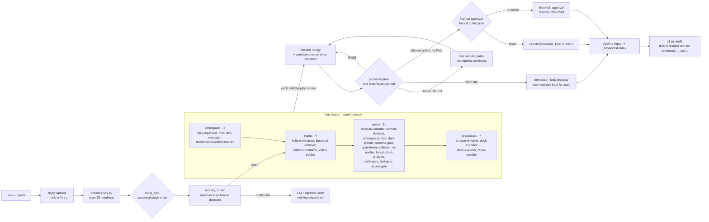

# Chelate Shell

**Twenty-five research and engineering skills routed as one deterministic pipeline, which stops before the one step that cannot be undone.**

Each skill solves a single problem. What is left is deciding what runs first and where the output lands; Chelate Shell puts the skills, the stage order and the gates in one repository.

**English** · [简体中文](README_zh.md)

**Version:** 1.4.0 | **License:** MIT | **Python:** 3.10+ | **Skills:** 25

> Research and engineering assistance only. Read [Safety and licensing](#safety-and-licensing) before relying on any output.

---

## Contents

**Start**

- [Why Chelate Shell](#why-chelate-shell)
- [Install and download](#install-and-download)
- [Quick start](#quick-start)
- [Things you can just ask](#things-you-can-just-ask)

**Going deeper**

- [How a run flows](#how-a-run-flows)
- [Repository layout](#repository-layout)
- [Full reference](#full-reference)
- [Security boundary](#security-boundary)

**Other**

- [Requirements](#requirements)
- [Tests](#tests)
- [Safety and licensing](#safety-and-licensing)
- [Known limitations](#known-limitations)
- [Issues and feedback](#issues-and-feedback)
- [Acknowledgements](#acknowledgements)
- [Trademarks](#trademarks)
- [License and author](#license-and-author)

---

## Why Chelate Shell

Skill repositories are full of single-purpose tools: check a formula, track a video, tidy up files. On a long task an agent still has to work out which one to call, in what order, and where the output goes, and loose stateless calls leave context pollution, muddled file versions and confident nonsense behind. Chelate Shell deals with that in two ways, in one repository.

- **The 25 skills implement their algorithms in code.** `formula-validator` runs five check layers over SymPy and cross-checks units with pint; `quantitative-validator` balances chemical equations through RDKit; `longitudinal-analysis` calls lme4 and lavaan in R; `video-tracker` performs CSRT tracking in OpenCV and computes an FFT of the trajectory; `ml-auditor` checks labelled datasets for leakage and label errors with scikit-learn; `sci-visualizer` renders publication-grade charts; `fulltext-extractor` pulls page ranges out of PDFs; `latex-exporter` assembles the Markdown reports into a compilable `.tex` using the standard library only.
- **The orchestrator does the part a single skill cannot.** `core/router.py` breaks the task down, enforces the four-zone workspace and routes in a fixed stage order, so the same input produces the same plan. Every call writes a typed gate, the first `FAIL` stops the pipeline, and a missing dependency is reported as `UNVERIFIED` rather than silently skipped.
- **The irreversible step needs a person.** Promoting `process/` into `results/` requires an approval a human issued for that exact manifest. The signing key lives outside the workspace, so an agent cannot mint one. Without it the run still finishes, writes nothing to `results/` and exits non-zero.

---

## Install and download

Install this repository as **one plugin**. Copying the folders under `skills/` into a global skill directory breaks microkernel auto-routing, which depends on the repository layout (`core/`, `lib/`, and one flat folder per skill).

**Most people take method one: let an AI install it.** Hosts with a plugin marketplace take method two; a terminal install, or several hosts at once, takes method three.

### Method one: let an AI install it

```bash
Visit the GitHub repository `https://github.com/JiamingShi-JsPhys/chelate-shell`, clone it, and run `python install.py --project . --global`. If your host has a plugin system, install the whole thing as a single plugin instead; that script covers the hosts that read rule files.
```

### Method two: install from a marketplace URL

```text
/plugin marketplace add https://github.com/JiamingShi-JsPhys/chelate-shell.git#v1.4.0
/plugin install chelate-shell@chelate-shell-marketplace
```

`#v1.4.0` pins the install to this release; drop it to follow the default branch. Registering the same URL twice is harmless; the second attempt reports that it already exists.

### Method three: install with commands

Claude Code, Codex, dsh and CodeBuddy install with a one-line plugin command; Cursor, Windsurf, Cline, Continue, Roo Code, GitHub Copilot and opencode read rule files, and one script writes all of them. Every command, every flag and the optional dependencies are on one page: **[docs/INSTALL_COMMANDS.md](docs/INSTALL_COMMANDS.md)**.

The npm registry is covered there too. The published tarball contains the same tree as the release zip: `index.js`, the DSH patch, `core/`, `lib/`, `contracts/`, `commands/`, `agents/` and all 25 folders under `skills/`, so it suits a project dependency or a DSH profile:

```bash
npm install chelate-shell                        # as a dependency in a project
dsh plugin --profile <profile> add chelate-shell # into a DSH profile
```

An npm install places the files; it does not register the plugin with a host, so Claude Code, Codex, CodeBuddy and the rule-file hosts still need the commands above for that step. Optional skill dependencies (`pandas`, `sympy`, `rdkit`, …) are never installed by this package; see [Requirements](#requirements).

### Keeping an installed copy current

A host installs the plugin into its own cache, so the running copy is frozen at installation time and a fixed bug keeps running until that cache is refreshed. Two commands close the gap:

```bash
python cli.py update            # does this copy still match main?
python cli.py update --apply    # run each host's own update command
```

`update` compares the files this copy is running with `main` (line endings aside, because version numbers do not move during a release window) and names the ones that differ. `--apply` runs `zcode plugins …` or `claude plugin update` for every host that has the plugin installed and reports each step. Both are best-effort: an offline machine is "unknown", not an error. `cli.py pipeline` and `cli.py audit` print one stderr line when the copy has drifted, checked at most once a day and cached; `CHELATE_UPDATE_OFF=1` silences it.

---

## Quick start

### From the chat box

Once the plugin is installed you stay in the chat: type `/` and pick a skill. No terminal and no absolute paths are needed, because the workspace is the folder you are already working in. All 25 skills live under the `chelate-shell` namespace:

```text
/chelate-shell:task-organizer      turn this folder into a task workspace
/chelate-shell:formula-validator   check F = m*a with F=N, m=kg, a=m/s^2
/chelate-shell:reference-auditor   verify every DOI in draft.md against Crossref
/chelate-shell:security-guard      screen draft.md for prompt injection
/chelate-shell:data-profiler       profile data.csv
```

Say what you need after the name; the skill picks the action and writes a gate result. A fabricated DOI makes the gate `FAIL` and stops the pipeline.

### Two commands that wrap the heavier engines

| Command | Does |
|---|---|
| `/chelate-shell:figure` | Chart a CSV or JSON dataset (bar / line / scatter / box) into `process/figures/`, as a vector PDF and a raster PNG |
| `/chelate-shell:model3d` | Generate a Wavefront `.obj` from a JSON spec, or audit and merge an existing mesh, into `process/models/` |

```text
/chelate-shell:figure data.csv — scatter of voltage against time
/chelate-shell:model3d spec.json
```

Both run inside the sandbox with a 120-second fuse: bad input degrades to `UNVERIFIED` instead of wedging the pipeline.

### Two subagents registered with the plugin

| Subagent | Use it for | Skills it may call |
|---|---|---|
| `spatial_agent` | 3D work: image to 3D, video to 3D, scene composition, mesh QA | 3d-modeler, sci-visualizer, security-guard |
| `visual_agent` | Publication visuals: 2D charts, diagrams, gif frames, figure QA, LaTeX export | sci-visualizer, latex-exporter, security-guard |

The host routes matching work to them automatically, or you can name one. Each is constrained by a skill whitelist, a writable-path whitelist (`assets/`, `process/`, `results/`) and a step budget, so it cannot wander outside its role.

### From a terminal

The same operations run headless, for CI and scripts:

```bash
python cli.py list                                           # the 25 skills
python cli.py run task-organizer --root <ws> --action init   # make a workspace
python cli.py run data-profiler --root <ws> --input data.csv # run one skill
python cli.py pipeline --root <ws> --mode a                  # run, then submit
python cli.py pipeline --root <ws> --summary                 # one line per skill, no JSON dump
python cli.py approve --root <ws>                            # bind an approval to those bytes
python cli.py publish --root <ws>                            # publish exactly what was approved
python cli.py memory add "units are cgs" --root <ws>         # record a note
python cli.py memory brief --root <ws>                       # read the notes back
python cli.py doctor --root <ws>                             # what a clean machine would skip
python cli.py broker start --root <ws>                       # the 1.4.0 publication boundary
python cli.py skill new my-gate --stage gates                # scaffold a skill
python cli.py skill lint                                     # manifest / SKILL.md / README agree?
```

The `a` / `b` / `c` pipeline modes, every flag and the debug switches are in [ORCHESTRATOR.md](ORCHESTRATOR.md) §5.

### What a run looks like

```text
> /chelate-shell:formula-validator   v = d/t    units: v=m, d=m, t=s

FAIL · SYMBOLIC
pint unit mismatch — LHS [length], RHS [length]/[time]
gate    → process/gates/formula-validator_20261112T130046Z.json
report  → process/reports/equation-4c9b2ce5-20261112-210045.md
```

A wrong dimension produces a failed gate, a report on disk, and a pipeline that stops.

---

## Things you can just ask

| Say it your way | Routes to | You get back |
|---|---|---|
| "Check `F = m*a` with F=N, m=kg, a=m/s²" | `formula-validator` | PASS / FAIL from five check layers, plus a Markdown report |
| "Verify every DOI in draft.md" | `reference-auditor` | each one checked against Crossref; a fake DOI fails the gate |
| "Do these two drafts agree?" | `conflict-detector` | every contradiction, with a severity |
| "Profile data.csv" | `data-profiler` | rows, missing values, 1.5·IQR outliers, duplicate rows |
| "Does this labelled dataset leak?" | `ml-auditor` | a leakage and label-error verdict, via scikit-learn |
| "Chart voltage against time" | `sci-visualizer` | vector PDF plus PNG in `process/figures/` |
| "Extract pages 3–7 of these PDFs" | `fulltext-extractor` | plain text plus a JSON sidecar in `process/` |
| "Find recent papers on X" | `literature-retriever` | arXiv metadata, stored as JSON |
| "Track the ball in this video" | `video-tracker` | coordinates, an FFT spectrum, physics-consistency probes |
| "Assemble my report into LaTeX" | `latex-exporter` | one `.tex` that compiles |
| "Generate this mesh and check it" | `3d-modeler` | an OBJ plus winding / degenerate-face / bounding-box audit |
| "Is this text trying to inject instructions?" | `security-guard` | injection markers and dangerous call sites |

All 25 skills and what each one computes: [repository layout](#repository-layout) and [docs/REFERENCE.md](docs/REFERENCE.md).

---

## How a run flows

`core/router.py` reads the 25 manifests, builds a plan in the canonical stage order, screens text inputs for prompt injection before dispatch, then calls each skill adapter.

| Stage | Does |
|---|---|
| `workspace` | `task-organizer` creates `material/initial/`, `process/`, `results/` |
| `ingest` | normalises inputs into `process/` |
| `gates` | every gate writes a result; the first `FAIL` terminates the pipeline and locks `process/` |
| `processors` | clean, transform and export into `results/` |

Every call writes a `GateResult`. `PASS` continues, `UNVERIFIED` degrades only that skill, and the first `FAIL` locks `process/` and stops the run. The lock survives the run: while the newest gate for a skill is `FAIL`, promotion is refused, and a later narrower run cannot route around a failure it did not re-run.

Promoting `process/` into `results/` is the one irreversible step, so it needs an approval a human issued for that exact plan:

```bash
python cli.py approve  --root <ws> --mode a     # type the confirmation phrase
python cli.py publish  --root <ws>              # publish exactly those bytes
```

The approval is bound to the action, the resolved workspace, the mode and selected skills, the SHA-256 of every input file, the manifest digest and a 15-minute expiry. The signing key lives outside the workspace, so an agent cannot mint one. Without it the run still completes, the attempt stays visible in `process/`, and the process exits non-zero with nothing written to `results/`.

The gate guards `promote()`, not the directory: an agent holding a file-writing tool can still copy its own file into `results/`, and in a measured session one did. So every promotion is recorded in `results/.promotions.jsonl` (the token that authorised it, the hash of every file it copied), and `python cli.py audit --root <ws>` names every file in `results/` that no promotion accounts for, exiting 1; each pipeline report carries the same `results_audit`.



---

## Repository layout

`core/` is the microkernel, `lib/chelate_core/` holds the shared logic every adapter imports, `skills/` has one folder per skill (flat, because host scanners do not descend into namespace folders), and each host's plugin manifest or rule file gets its own dot-directory.

```text
chelate-shell/
├── cli.py                 # list / run / pipeline / approve / publish / audit / status / memory / update
├── core/                  # router, approval, sandbox, security_shield, registry
├── lib/chelate_core/      # shared logic (paths, DOI, BibTeX, debug layer)
├── skills/                # 25 skills, one flat folder each
├── agents/                # subagents registered with the plugin
├── commands/              # slash commands (figure / model3d / trace / brainstorm)
├── docs/                  # architecture, reference, safety, testing, dependencies
└── tests/                 # root suite + the adversarial cases
```

Per-directory detail, and what each of the 25 skills computes: **[docs/REFERENCE.md](docs/REFERENCE.md)**.

## Full reference

Record shapes, every command and flag, exit codes, per-skill input types and dependencies, and directory detail live in **[docs/REFERENCE.md](docs/REFERENCE.md)**, so this page stays a quick start. The ones you meet most:

| Exit code | Means |
|---|---|
| `0` | the plan completed; promoted to `results/` when an approval was present |
| `1` | a gate `FAIL`, an unknown skill name, or `audit` found a deliverable with no promotion behind it |
| `2` | the approval was refused (the person typed something else) |

---

## Security boundary

This pipeline writes files and runs external commands, so the boundaries are in the code rather than left to the caller's memory.

- **The one irreversible step needs a person.** Promotion needs a token bound to the plan: action, workspace, mode/selection, the hash of every input file, a 15-minute expiry, an HMAC-SHA256 signature, spent atomically (`O_CREAT|O_EXCL`) so it cannot be replayed. The key lives in `%LOCALAPPDATA%\chelate\keys\` (or `$XDG_DATA_HOME`), never in the workspace.
- **The issuing side is out of reach too.** Issuing requires an interactive terminal and a **typed** `approve promote`; EOF, a pipe or any other answer is a refusal. `CHELATE_UNSAFE_AUTO_APPROVE=1` is the CI hatch, named after its actual strength: it is an environment variable, so anything that can set one, an agent included, can set it. It records a declaration that nobody is watching, not a human approval, and the promotion log says `scripted-run`.
- **A check expires when what it checked changes.** Every gate records the SHA-256 of the files it was handed and a digest of the skill's own code. Edit or delete one of them afterwards and the gate is stale: promotion is refused, naming the file, until that skill is re-run. An `UNVERIFIED` gate, a check that could not be made, no longer carries anything into `results/` unless a person bound `--allow-unverified` into the token.
- **Publication is one rename.** The copy is staged and renamed onto `results/`, so an interrupted promotion leaves nothing half-published. A symlink pointing out of the workspace, or a hardlink, is refused at that boundary instead of being copied.
- **The run reads frozen inputs.** Declared inputs are copied into `.chelate/snapshots/<content-id>/` before dispatch and the skills are handed those paths, so a file edited mid-run cannot change what a check saw. Inputs above 256 MiB are dispatched from their original path and reported as such.
- **What was issued can be withdrawn.** `cli.py revoke` deletes unspent approvals; `cli.py rotate-key` replaces the signing key and invalidates every token issued under it, while old promotion records keep verifying.
- **The injection screen reads Chinese.** It normalises full-width forms, zero-width characters and Cyrillic/Greek homoglyphs before matching, inspects HTML comments, decodes base64 once, and requires the object of the verb to be a prompt artefact so ordinary prose (`忽略不计`) passes.
- **Containment and the sandbox.** `ensure_within()` resolves both paths with `realpath` before comparing, so `--output ../../x`, `workspace(root, "..")` and outward-pointing symlinks are refused before any write happens. The sandbox checks the child's `cmd[0]` against a whitelist before the process exists, and again inside the child.
- **Memory is data, and only a person writes it.** `cli.py memory` keeps workspace notes in `.chelate/memory/memory.jsonl`, append-only and hash-chained: each entry carries its own digest and the previous one's, so an edited entry is named by `memory verify` at the line it broke, and a store whose chain no longer holds refuses to grow. No skill and no MCP tool can write; `chelate_memory` reads only. An entry that would read as an instruction is refused at write time, because `brief` replays it to a later session as data. Wire it into a session start through `chelate.hooks.json` (`session_start` → `python cli.py memory brief --root .`).
- **Auditable afterwards.** Every promotion is recorded in `results/.promotions.jsonl`, and `cli.py audit` names what no promotion accounts for, exiting 1.

Threat model, the 26 adversarial cases (including how three self-approval routes were closed and why two probes are reported as passing), the 17 promotion-integrity cases, and the known boundary: **[docs/SAFETY.md](docs/SAFETY.md)**.

**Evidence.** The adversarial matrix is `tests/test_irreversible_actions.py`, 26 cases, each written as "the agent tries X, the shell must not do it"; `tests/test_promotion_integrity.py` adds 17 cases for gate freshness, the unverified block and atomic publication; two scripts that attempt self-approval live in `tests/attacks/`. A runnable end-to-end example, a tight-binding band structure with five attacks on it, is `examples/graphene-tight-binding/run_demo.py`, and the measured output is in [docs/SAFETY.md](docs/SAFETY.md#reproducing-the-demonstration). The static-analysis result (0 findings on shipped code) is [here](docs/SAFETY.md#static-analysis). What each layer measured, which adversary it covers, and the three rates with their scope: **[docs/SECURITY_REPORT.md](docs/SECURITY_REPORT.md)**.

---

## Requirements

Python 3.10+ and nothing else up front: the microkernel and most skills use the standard library only. A few data and network skills use common third-party packages (numpy, pandas, sympy, rdkit, matplotlib, requests, …). Each skill's `manifest.json` states what it needs and `core/sandbox.py` checks it at run time; a missing package never crashes the pipeline, that skill degrades to an `UNVERIFIED` gate and the rest keep running. On a machine with none of them installed, mode `a` still runs, but six of the ten gates return `UNVERIFIED` and promotion is refused, because an `UNVERIFIED` gate publishes nothing unless a person bound `--allow-unverified` into the token. Install what your plan needs first. This repository bundles no third-party code, and every library keeps its own permissive licence. The per-skill matrix is in [docs/DEPENDENCIES.md](docs/DEPENDENCIES.md).

## Tests

```bash
python -m pytest tests/ -q                                 # the full suite
python -m pytest tests/test_irreversible_actions.py -q    # the 26 adversarial cases
```

772 tests: 760 pass and 12 skip with the optional dependencies installed; in a pytest-only environment the dependency-gated cases skip instead, and what runs is the `UNVERIFIED` path a fresh user meets. Seven skills also keep their own upstream suites under `skills/<skill>/tests/`, each run in its own process. Both environments, the coverage list and the per-skill counts: **[docs/TESTING.md](docs/TESTING.md)**. What the routing layer costs in context every session, measured, and what 1.4.0 changed: **[docs/TOKEN_BUDGET.md](docs/TOKEN_BUDGET.md)**.

## Safety and licensing

> **Disclaimer**: this repository contains tooling the author wrote to automate research workflows; it is not a peer-reviewed academic project. Some boilerplate or utility code may have been produced with AI assistance and was reviewed and integrated at a high level. The author takes no responsibility for third-party code problems, but will address any reasonable report promptly.
>
> This tool **never does the experiment for you**. Data must be collected by hand in the lab, with the AI physically isolated from that step. The reports it produces are data-analysis drafts; academic responsibility rests with the user and their institution.

## Known limitations

Read these before relying on any output or on this safeguard.

- **The approval layer is policy, not containment.** Once a human has approved anything in a workspace, the signing key persists in the per-user directory, so any process running as that user can read it and sign its own token. It stops an agent that did not go looking; real containment needs an OS boundary (a separate user, a container, a syscall filter). It also guards the `promote()` function, not the `results/` directory. Writing a file into `results/` by hand needs no token, and in a measured session an agent did exactly that; `python cli.py audit` names such files afterwards. The measured record and the execution whitelist are in [docs/SAFETY.md](docs/SAFETY.md).
- **Automatic ROI detection fails on hard footage.** `video-tracker` can lose the object in low-contrast video; every run must be checked against a known reference. Marked *experimental / unstable*.
- **A formula check is not a proof.** `formula-validator` gives a deterministic verdict, and `unknown` means one check abstained, a legitimate state that must never be read as a pass.
- **Longitudinal analysis needs R.** Some of `longitudinal-analysis`'s advanced steps run through R; without `Rscript` they are skipped and logged. **Never hand-write Python to replace a skipped R step.**
- **Version tracking is structural, not semantic.** `document-evolution-tracker` aligns blocks and diffs them; a concept "exists" only where it matches literally.
- **DOI auditing checks existence only.** `reference-auditor` confirms the DOI resolves at Crossref; it does not confirm it is the paper you meant; that is still the author's job.
- **Injection screening is a filter, not a sandbox.** `security-guard` marks known patterns and dangerous call sites; it cannot prove a file is safe.
- **Leakage and label checks are heuristics.** `ml-auditor` sees only columns that the label (almost) determines; when the features carry no signal it declines to judge label quality and returns `UNVERIFIED`.
- **Profiling does not clean.** `data-profiler` reports missing values, outliers and duplicates; it never modifies the input.
- **Determinism stops at the scheduler.** The orchestrator routes the same input to the same skill; it cannot make an inherently non-deterministic algorithm deterministic.

## Issues and feedback

**Ordinary bugs and feature requests**: the repository's [Issues](https://github.com/JiamingShi-JsPhys/chelate-shell/issues) page, with reproduction steps, expected behaviour, actual behaviour and your environment (OS, Python version).

**Security vulnerabilities (this category only)**: do **not** use the public issue tracker. Use GitHub's private reporting form (the **Security** tab → **Report a vulnerability**), as described in [SECURITY.md](SECURITY.md).

- **Title**: must start with `report_chelate-shell:` plus the skill name and a short summary.
  - Example: `report_chelate-shell: path traversal can read outside the task folder`
- **Body**: must contain detailed reproduction steps and the environment.
- For serious reports about lost or corrupted files, include the before/after directory tree (`tree` output) and the generated `verification_report.md`.

*Contributors who file clear, reproducible issues or pull requests are credited in the next release's notes.*

## Acknowledgements

**NotFatJustRound**: [issue #1](https://github.com/JiamingShi-JsPhys/chelate-shell/issues/1) asked for CI and found that the npm `files` list was dropping core code.

**DeepSec**: the code-security auditor this repository is scanned with. It found the two command-injection paths closed in 1.3.2, and in 1.3.4 it turned the update check from "carries a URL argument" into "can only request two fixed addresses".

**Claude** (Anthropic): parts of the code, tests, documentation and release notes were written jointly with the author. Every change was reviewed and kept only where a test or a check could confirm it.

Some friends, who used this plugin for tests in mathematics, theoretical physics and experimental physics, helped me improve it from 1.3.3 to 1.3.4 through real use.

[Full acknowledgements](docs/ACKNOWLEDGEMENTS.md)

## Trademarks

"Claude", "Codex", "CodeBuddy", "Cursor", "Windsurf", "Cline", "Continue", "Roo Code", "GitHub Copilot", "ZCode", "arXiv", "Crossref", "RDKit", "SymPy" and "LaTeX" are trademarks or registered trademarks of their respective owners. Chelate Shell is an independent third-party tool with no affiliation, endorsement or sponsorship from any of them.

---

## License and author

The repository as a whole is released under the [MIT License](LICENSE); each skill folder also carries its own `LICENSE` with the same terms, and third-party components are listed in [THIRD_PARTY_LICENSES.txt](THIRD_PARTY_LICENSES.txt).

**Author and maintainer**: Jiaming Shi (Westlake University)
