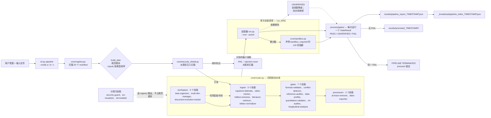

# Chelate Shell（螯合壳）

> **面向科研与工程工作流的确定性调度器，自带 20 个技能。**
>
> 使用它不需要你先准备技能：20 个科研与工程技能随仓库一起交付，覆盖公式校验（SymPy 五层判定 + pint 单位交叉校验）、基于 RDKit 的原子守恒、经 R 执行的混合模型与中介分析、基于 OpenCV 的视频轨迹提取、出版级统计图、PDF 文本抽取，以及 Markdown → 可编译 LaTeX 导出。全部 20 个都在安装内容里，按交付状态即可进入流水线运行。


[English](README.md) · **简体中文**

**版本：** 1.3.1 | **技能数：** 20

---

## 安全与开源声明

> **免责声明**：本仓库包含作者为自动化科研工作流而开发的辅助工具，并非经过同行评审的学术项目。部分样板代码或实用脚本可能在 AI 辅助下生成，并经过作者高层面的审查与修改整合。作者对任何第三方代码问题不承担责任，但承诺及时处理任何合理的诉求。
>
> 本工具**永远不会代替你做实验**。数据必须由学生在实验室手动采集，AI 在实验环节物理隔离。生成的报告仅为“数据分析草稿”，最终学术责任由使用者本人及所在机构承担。

---

## 为什么需要 Chelate Shell？

当前 AI 生态里，每个技能（Skill）都在解决单点问题：校验公式、追踪视频、整理文件。但当 Agent 面对复杂任务时，它常常不知道**该按什么顺序、在什么位置调用哪个技能**。散落的、无状态的技能调用，往往会导致上下文污染、文件版本混乱、甚至产生不可信的 AI 幻觉。

Chelate Shell 从两个层面回应这个问题，两者都在同一个仓库里。

**20 个技能直接实现各自的算法**，不是提示词模板。`formula-validator` 在 SymPy 之上执行五层判定，并用 pint 交叉校验单位；`quantitative-validator` 通过 RDKit 配平化学方程式；`longitudinal-analysis` 在 R 中调用 lme4 与 lavaan；`video-tracker` 在 OpenCV 中执行 CSRT 跟踪并对轨迹计算 FFT；`ml-auditor` 用 scikit-learn 检查标注数据集的数据泄漏与标签错误；`sci-visualizer` 用 matplotlib 与 seaborn 渲染出版级统计图；`fulltext-extractor` 按页区间抽取 PDF 文本；`latex-exporter` 仅用标准库把 Markdown 报告合成为可编译的 `.tex`。每个技能都已接入流水线，并纳入测试套件。

**调度器提供单个技能无法自行提供的保证。** `core/router.py` 拆解任务、强制四区工作区结构，并按确定性的阶段顺序路由，使相同输入始终产生相同计划；同时为每次调用写下一个类型化门禁，在第一个 `FAIL` 处停止流水线，缺少依赖时明确报告 `UNVERIFIED`，并维护 `_broadcast/` 索引，使后续会话只读一份摘要而不必打开所有原件。

---

## 架构与流水线

`core/router.py` 是微内核：它读取 20 个 `manifest.json`，按规范阶段顺序生成计划，在派发任何技能**之前**先对文本输入做提示注入扫描，然后逐个调用技能的适配器。每次调用都会在 `process/gates/` 写下一个 `GateResult`——`PASS`、`UNVERIFIED` 或 `FAIL`。

缺依赖时只把该技能降级为 `UNVERIFIED`，流水线继续。单个 `FAIL` 是终止态：流水线当场停止，中间产物锁在 `process/` 里。没有任何门禁失败时，`process/` 会被提升到 `results/`，同时写出类型化的流水线报告和 `_broadcast/` 索引——后续会话先读索引，再决定打开哪些原件。



图里刻意说明的三件事：

- **自动流水线是 `ingest → gates → processors`。** `workspace`（task-organizer）是任务开始时的书挡，在流水线之前或通过 `--selected` 进入；`--mode a` 不会自动调度它。
- **`UNVERIFIED` 不是失败。** 它表示该技能无法给出判定——缺可选依赖、调用方还没提供输入——其余流程照常继续。
- **只有 `FAIL` 是终止态。** 它把 `process/` 原样锁在中断处，中间产物可审计，但不会被误当成结果。

---

## 安装与下载

一共三种装法。有插件市场的宿主把整套装成**一个插件**——这是保留微内核自动调度的唯一形式；没有插件通道的宿主则以**规则文件**接入，一个脚本就能把全部规则文件一次写好；第三种是把这件事直接交给 AI。

### 方法一：从插件市场用 URL 安装

下面每个宿主都有自己的插件市场。把本仓库的 Git URL 注册进去，再安装它列出的插件即可（URL 重复注册没有副作用，第二次会提示已存在）。

```bash
https://github.com/JiamingShi-JsPhys/chelate-shell
```

### 方法二：用命令安装

Claude Code、Codex、dsh、CodeBuddy 用一行插件命令安装；Cursor、Windsurf、Cline、Continue、Roo Code、GitHub Copilot 与 opencode 读规则文件，一个脚本把这些文件一次写好。全部命令、全部参数与可选依赖集中在一页：**[docs/INSTALL_COMMANDS_zh.md](docs/INSTALL_COMMANDS_zh.md)**。
### 方法三：让 AI 帮你装

```bash
请访问 GitHub 仓库 `https://github.com/JiamingShi-JsPhys/chelate-shell` 并克隆它，然后运行 `python install.py --project . --global`。如果你的宿主有插件系统，请改为把整套作为单一插件安装；该脚本覆盖的是读规则文件的那些宿主。
```

> **警告**：使用 AI 自动安装时，AI 有概率会将 `skills/` 目录下的独立技能直接打散，平铺复制到平台的全局技能目录中。这会导致 Chelate Shell 的“微内核自动调度架构”失效，退化为 20 个散装技能。如果你需要完整的插件调度功能，请使用方法一。

## 快速上手

装好插件后不用离开对话框：输入 `/` 选择技能或命令即可。不需要开终端，也不需要写绝对路径——工作区就是你当前正在操作的文件夹。

### 技能

20 个技能全部注册在 `chelate-shell` 命名空间下，一个 `/` 就能调出来：

```text
/chelate-shell:task-organizer      把这个文件夹初始化成任务工作区
/chelate-shell:formula-validator   校验 F = m*a，单位 F=N、m=kg、a=m/s^2
/chelate-shell:reference-auditor   核验 draft.md 里的每条 DOI 是否存在于 Crossref
/chelate-shell:security-guard      扫描 draft.md 的提示注入与危险调用
/chelate-shell:data-profiler       体检 data.csv
```

技能名后面直接说你要做什么，由技能自己决定执行哪个动作，并写下一个门禁结果。假 DOI 不是提示一下就放过——它会让门禁 FAIL 并终止流水线。

### 1.3.0 新增的命令

两条命令把较重的引擎收成一行：

| 命令 | 作用 |
|---|---|
| `/chelate-shell:figure` | 从 CSV 或 JSON 数据集出图（柱状 / 折线 / 散点 / 箱线），输出到 `process/figures/`，同时给矢量 PDF 与位图 PNG |
| `/chelate-shell:model3d` | 从 JSON 规格生成 Wavefront `.obj`，或审计、合并已有网格，输出到 `process/models/` |

```text
/chelate-shell:figure data.csv —— 画电压随时间的散点图
/chelate-shell:model3d spec.json
```

两者都在沙箱内运行并带 120 秒熔断：输入异常时降级为 `UNVERIFIED`，不会把整条流水线卡住。

### 1.3.0 新增的子代理

`agents/` 下的两个角色随插件一起注册：

| 子代理 | 适用场景 | 可调用的技能 |
|---|---|---|
| `spatial_agent` | 3D 内容——图像转 3D、视频转 3D、场景合成、网格质检 | 3d-modeler、sci-visualizer、security-guard |
| `visual_agent` | 出版级视觉——二维图表、静态示意图、gif 逐帧、出图质检、LaTeX 导出 | sci-visualizer、latex-exporter、security-guard |

任务匹配时 Claude 会自动交给它们，也可以在请求里点名。每个子代理都受技能白名单、可写路径白名单（`assets/`、`process/`、`results/`）与步数预算约束，越不出自己的角色范围。

### 需要命令行时

同样的操作也可以无头运行，供 CI 与脚本调用；参数、`a` / `b` / `c` 三种流水线模式与调试开关见 [ORCHESTRATOR.md](ORCHESTRATOR.md) §5。

## 环境要求

只需要 Python 3.10+，别的都不用提前准备：微内核与多数技能仅依赖标准库。少数数据处理与网络类技能会额外用到常见的第三方包（numpy、pandas、sympy、rdkit、matplotlib、requests 等）；每个技能的 `manifest.json` 精确声明了自己需要什么，运行时由 `core/sandbox.py` 检查。缺包不会让流水线崩溃——只有那一个技能会带提示降级为 `UNVERIFIED` 门禁，其余照常运行。本仓库不内置任何第三方代码，每个库仍保持其自身的宽松许可。逐技能的完整依赖矩阵见 [docs/DEPENDENCIES_zh.md](docs/DEPENDENCIES_zh.md)。

## 仓库布局

```text
chelate-shell/
├── .claude-plugin/                   # Claude Code 插件清单 + marketplace
├── .clinerules/                      # Cline 规则文件
├── .codebuddy-plugin/                # CodeBuddy 插件清单 + marketplace
├── .codex-plugin/                    # Codex 插件清单 + marketplace
├── .continue/rules/                  # Continue 规则目录
├── .cursor/rules/                    # Cursor 规则文件（.mdc）
├── .dsh-plugin/                      # DeepSeek Harness CJS 入口（apply(ctx)）
├── .github/                          # GitHub Copilot 指令文件
├── .gitignore
├── .roo/rules/                       # Roo Code 规则目录
├── .windsurf/rules/                  # Windsurf 规则文件
├── agents/                           # 子 Agent 角色定义
│   ├── spatial_agent.md              # 网格/3D 角色（3d-modeler）
│   └── visual_agent.md               # 图表/可视化角色（sci-visualizer + latex-exporter）
├── AGENTS.md                         # 通用 Agent 规范（Codex / Cursor / Copilot / opencode）
├── assets/                           # icon.png（各插件清单共用）
├── bootstrap.py                      # 各 run.py 共用的导入与门禁写入工具
├── CHANGELOG.md                      # 版本发布说明
├── cli.py                            # 命令行入口：list / run / pipeline
├── commands/                         # 斜杠命令
│   ├── figure.md                     # /figure —— 从 CSV 或 JSON 数据集出图
│   └── model3d.md                    # /model3d —— OBJ 网格生成 / 合并 / 审计
├── contracts/                        # 全局通信契约
│   ├── __init__.py
│   ├── gate_result.py                # {skill, status, evidence_level, reason, artifacts}
│   └── schema.json                   # manifest.json 的强校验规范
├── cordis.patch.yml                  # cordis bundle 补丁
├── core/                             # 微内核
│   ├── __init__.py
│   ├── registry.py                   # 扫描 skills/ 并注册进路由表
│   ├── router.py                     # 确定性调度器（解析 manifest 生成流水线）
│   ├── sandbox.py                    # 依赖隔离与 120 秒超时熔断
│   ├── security_shield.py            # 提示注入文本扫描 + AST 危险调用扫描
│   └── subagent_manager.py           # 子 Agent 角色注册表
├── docs/                             # 设计笔记、审计报告、文件功能映射
├── index.js                          # CJS 插件入口（dsh 生态）
├── install.py                        # 一条命令装好所有规则文件的安装器（见安装章节）
├── lib/chelate_core/                 # 共享底层逻辑库（逻辑住在这里）
│   ├── __init__.py
│   ├── adapter.py                    # 薄适配器工具箱：argparse、门禁发射、legacy 运行器
│   ├── arxiv_search.py               # arXiv 搜索核心
│   ├── bibtex_norm.py                # BibTeX 解析 / 去重 / 规范化核心
│   ├── csv_profile.py                # CSV 体检核心（pandas）
│   ├── debug.py                      # 贯通全链路的 [chelate:debug] 开关
│   ├── doi_audit.py                  # DOI 抽取 + Crossref 核验核心
│   ├── formula_merge.py              # legacy D1-D5 + pint 裁决合并策略
│   ├── paths.py                      # 路径解析
│   ├── pdf_text.py                   # PDF 提取核心（pdfminer.six / pypdf）
│   └── yamlmini.py                   # assets/config.yaml 加载
├── LICENSE
├── ORCHESTRATOR.md                   # 给 Agent 看的路由契约（v1.3.0）
├── package.json                      # npm/dsh 打包元数据
├── README.md
├── README_zh.md
├── skills/                           # 20 个技能，全部平铺——一个技能一个目录
│   ├── 3d-modeler/                   # [domain_extensions] 纯 Python OBJ 网格
│   │                                 # 生成 / 合并 / 审计，含网格质检；沙箱运行
│   ├── ai-trace-remover/             # [processors] 模板句清除与 0–100「AI 味」评分
│   │                                 # （英文 + 中文词表）
│   ├── bibtex-normalizer/            # [ingest]    .bib 解析、去重、规范化输出
│   ├── capstone-labmate/             # [ingest]    PASCO Capstone .cap 二进制解析、
│   │                                 # CSV/JSON 转换、带水印的草稿报告
│   ├── conflict-detector/            # [gates]     跨文档矛盾引擎，正则数字抽取
│   ├── data-profiler/                # [gates]     pandas CSV 体检：行数、缺失值、
│   │                                 # 1.5·IQR 异常值比率、重复行、常值列
│   ├── document-evolution-tracker/   # [workspace] 跨文档版本的段落级 diff、
│   │                                 # 概念谱系追踪
│   ├── formula-validator/            # [gates]     SymPy D1–D5 层（量纲分析、极限枚举、
│   │                                 # 数值采样、符号证明）+ pint 单位交叉校验
│   ├── fulltext-extractor/           # [ingest]    pdfminer.six 文本提取进 process/
│   │                                 # （pypdf 回退）
│   ├── latex-exporter/               # [processors] 把 process/ 下的 Markdown 与 process/figures/
│   │                                 # 下的图形合并为一个可编译 .tex
│   ├── literature-retriever/         # [ingest]    arXiv 关键词搜索转 JSON
│   ├── longitudinal-analysis/        # [gates]     时间序列 OLS 加 R 支撑的 LMM（lme4）、
│   │                                 # 中介分析（lavaan）、敏感性分析；
│   │                                 # 缺少 Rscript 时降级为纯 Python 步骤
│   ├── ml-auditor/                   # [gates]     数据泄漏与标签错误审计，基于
│   │                                 # scikit-learn（cleanlab 可选）；沙箱运行
│   ├── multi-dim-manager/            # [workspace] 参数空间展开、SHA-256 快照、
│   │                                 # 哈希审计日志、回滚到任意历史轮次
│   ├── quantitative-validator/       # [gates]     分子式与化学方程式的原子守恒
│   │                                 # （Hill 记法文法 + rdkit 交叉校验）；沙箱运行
│   ├── reference-auditor/            # [gates]     DOI 抽取与 Crossref 核验；
│   │                                 # 假 DOI 直接 FAIL 门禁
│   ├── sci-visualizer/               # [generation] 出版级统计图（matplotlib +
│   │                                 # seaborn + pandas），含 AMOS 风格 SEM 路径图
│   │                                 # 渲染器，另可扫描 gif 逐帧
│   ├── security-guard/               # [infrastructure] 提示注入文本扫描 +
│   │                                 # AST 危险调用点扫描
│   ├── task-organizer/               # [workspace] 四区工作区初始化、文件整理
│   │                                 # （C1–C8 校验、去重、快照、撤销/重做）、
│   │                                 # _broadcast/INDEX.md 上下文索引
│   └── video-tracker/                # [ingest]    OpenCV 坐标提取（CSRT/Template）、
│                                     # FFT 频谱分析、物理一致性探针
├── tests/                            # 自动化测试套件（357 个测试）
└── THIRD_PARTY_LICENSES.txt          # 第三方许可清单
```

---

## 测试

```bash
python -m pytest tests/ -q
```

共 357 个测试（347 通过，10 跳过——来自 `rdkit` 等依赖门禁与 fixture 判定）。测试套件覆盖：门禁契约、清单 schema 校验、扁平布局强制（manifest 必须正好位于 `skills/` 下一层）、流水线规划与 FAIL 终止、迁移守卫、legacy D1–D5 与 FFT/物理探针、v1.1.x 新增的 5 个技能、工作区输入路径解析、`--inputs` 自动接线、统一调试层、清单契约套件（四平台插件清单，以及 SKILL.md frontmatter 一致性）、无插件宿主的规则文件适配器、安全护盾、4 个重型引擎技能的真实逻辑与 `UNVERIFIED` 降级，以及仓库一致性守卫：每个技能的文档、清单、入口、`LICENSE` 与声明依赖始终保持一致。

## 已知局限

诚实的边缘情况声明；依赖以下输出前请务必注意：

- **自动 ROI 检测会翻车**：`video-tracker` 在低对比度视频上可能失败，每次运行必须对照参考验证。标记为*实验/不稳定*。
- **公式检查不是数学证明**：`formula-validator` 是确定性判定。返回 `unknown` 代表某项检查“弃权”，这是合法状态，绝不能强行解释为通过。
- **纵向分析依赖 R 语言**：`longitudinal-analysis` 的某些高级统计步骤经由 R 脚本执行；若环境中缺失 `Rscript`，这些步骤会被跳过并记入日志，**绝不要试图用 Python 手写代码替代被跳过的 R 步骤**。
- **版本追踪是结构化而非语义化的**：`document-evolution-tracker` 按块对齐做 diff；某个概念只有在字面匹配时才被认为“存在”。
- **DOI 审计只验证存在性**：`reference-auditor` 确认 DOI 在 Crossref 中存在，不确认它就是你引用的那篇文献——引用正确性仍是作者的责任。
- **注入扫描是筛查而非沙箱**：`security-guard` 只能标记已知特征与危险调用点，无法证明一个文件绝对安全。
- **数据体检不洗数据**：`data-profiler` 只报告缺失值/异常值/重复行，从不修改输入文件。
- **确定性仅限调度层**：调度器能保证相同的输入路由到相同的技能，但无法让一个本身非确定性的底层算法变得确定。

## 报告问题与反馈

**常规 Bug / 功能建议**：首选在仓库的 [Issues](https://github.com/JiamingShi-JsPhys/chelate-shell/issues) 页面提交。提交时请附上：复现步骤、预期行为、实际行为以及运行环境（操作系统、Python 版本）。

**安全漏洞报告（仅限此类型）**：请**不要**在公开的 Issues 页面提交。请发送邮件至 `jiamingshi_git@outlook.com`。

- **邮件主题**：必须包含前缀 `_report` 以及具体技能名与简述。
  - 示例：`report_chelate-shell: 路径穿越漏洞可读取任务文件夹之外的路径`
- **邮件正文**：必须包含详细的复现步骤、运行环境。
- 针对“文件丢失或损坏”的严重报告，请附带前后目录树结构（`tree` 输出）与生成的 `verification_report.md`。

*提交清晰、可复现 Issue 或 Pull Request 的贡献者，将被列入下个版本 Release 说明的致谢名单。*
## 致谢

**NotFatJustRound** —— [issue #1](https://github.com/JiamingShi-JsPhys/chelate-shell/issues/1) 要求补上 CI，并发现了 npm `files` 列表漏掉了核心代码。

[完整致谢](docs/ACKNOWLEDGEMENTS_zh.md)

## 商标声明

“PASCO” 与 “Capstone” 是 PASCO Scientific 的注册商标。`capstone-labmate` 技能是独立的第三方互操作与教学辅助工具，与 PASCO Scientific 无隶属、赞助或背书关系。所有 `.cap` 解析均在本地运行；使用者有责任遵守所在机构的学术诚信政策。

## 开源许可与作者

本仓库整体采用 [MIT License](LICENSE) 发布，详见根目录下的 `LICENSE` 文件。每个技能目录也携带具有相同条款的独立 `LICENSE` 文件。

**作者与维护者**：Jiaming Shi（Westlake University）
