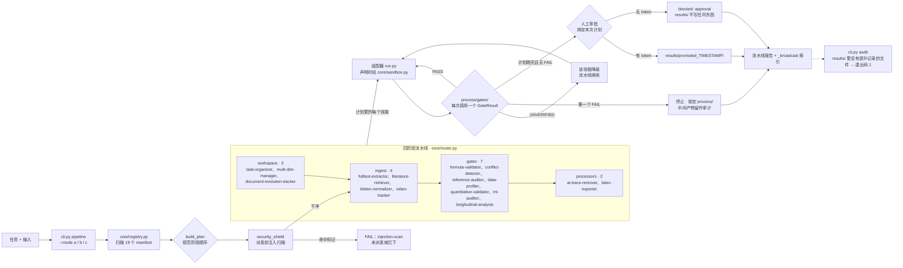

# Chelate Shell（螯合壳）

**把 19 个科研技能调度成一条确定性流水线，并在唯一不可逆的那一步之前停下来等人。**

技能各自解决单点问题，真正难的是谁先谁后、产物落在哪——Chelate Shell 把技能、阶段顺序和门禁放进同一个仓库。

[English](README.md) · **简体中文**

**版本：** 1.3.4 ｜ **许可：** MIT ｜ **Python：** 3.10+ ｜ **技能数：** 19

> 仅作科研辅助。依赖任何输出之前，请先读[安全与开源声明](#安全与开源声明)。

---

## 目录

**开始**

- [为什么选 Chelate Shell](#为什么选-chelate-shell)
- [安装与下载](#安装与下载)
- [快速上手](#快速上手)
- [你可以直接这样问](#你可以直接这样问)

**深入**

- [一次运行如何流转](#一次运行如何流转)
- [仓库布局](#仓库布局)
- [完整参考](#完整参考)
- [安全边界](#安全边界)

**其他**

- [环境要求](#环境要求)
- [测试](#测试)
- [安全与开源声明](#安全与开源声明)
- [已知局限](#已知局限)
- [报告问题与反馈](#报告问题与反馈)
- [致谢](#致谢)
- [商标声明](#商标声明)
- [开源许可与作者](#开源许可与作者)

---

## 为什么选 Chelate Shell

当前 AI 生态里每个技能都在解决单点问题：校验公式、追踪视频、整理文件。但当 Agent 面对复杂任务时，它常常不知道**该按什么顺序、在什么位置调用哪个技能**——散落的、无状态的调用会带来上下文污染、文件版本混乱，以及不可信的幻觉输出。Chelate Shell 从两个层面回应这个问题，两者都在同一个仓库里。

- **19 个技能直接实现各自的算法，不是提示词模板。** `formula-validator` 在 SymPy 之上执行五层判定并用 pint 交叉校验单位；`quantitative-validator` 通过 RDKit 配平化学方程式；`longitudinal-analysis` 在 R 中调用 lme4 与 lavaan；`video-tracker` 在 OpenCV 中执行 CSRT 跟踪并对轨迹计算 FFT；`ml-auditor` 用 scikit-learn 检查标注数据集的泄漏与标签错误；`sci-visualizer` 渲染出版级统计图；`fulltext-extractor` 按页区间抽取 PDF 文本；`latex-exporter` 仅用标准库把 Markdown 报告合成为可编译的 `.tex`。
- **调度器提供单个技能无法自行提供的保证。** `core/router.py` 拆解任务、强制四区工作区结构，并按确定性的阶段顺序路由，使相同输入始终产生相同计划；每次调用都写下一个类型化门禁，在第一个 `FAIL` 处停下，缺依赖时明确报告 `UNVERIFIED`。
- **唯一不可逆的一步需要一个人点头。** 从 `process/` 提升到 `results/` 必须有一条针对本次计划、由人签发的审批；密钥在工作区之外，agent 无法自签；没有审批时流水线照常跑完，但不会往 `results/` 写任何东西，并以非零码退出。

---

## 安装与下载

请按**一个完整插件**安装。不要用 AI 把 `skills/` 下的目录平铺复制到全局技能目录——微内核自动调度依赖仓库布局（`core/`、`lib/`、每个技能一个扁平目录）。

**大多数人走方法一：让 AI 帮你装。** 有插件市场的宿主走方法二；在终端里装、或同时装到多个宿主的，走方法三。

### 方法一：让 AI 帮你装

```bash
请访问 GitHub 仓库 `https://github.com/JiamingShi-JsPhys/chelate-shell` 并克隆它，然后运行 `python install.py --project . --global`。如果你的宿主有插件系统，请改为把整套作为单一插件安装；该脚本覆盖的是读规则文件的那些宿主。
```

### 方法二：从插件市场用 URL 安装

```text
/plugin marketplace add https://github.com/JiamingShi-JsPhys/chelate-shell.git#v1.3.4
/plugin install chelate-shell@chelate-shell-marketplace
```

`#v1.3.4` 把安装钉在这个发布上；去掉它则跟随默认分支。URL 重复注册没有副作用，第二次会提示已存在。

### 方法三：用命令安装

Claude Code、Codex、dsh、CodeBuddy 用一行插件命令安装；Cursor、Windsurf、Cline、Continue、Roo Code、GitHub Copilot 与 opencode 读规则文件，一个脚本把这些文件一次写好。全部命令、全部参数与可选依赖集中在一页：**[docs/INSTALL_COMMANDS_zh.md](docs/INSTALL_COMMANDS_zh.md)**。

### 保持已安装副本是最新的

宿主会把插件装进自己的缓存，所以真正运行的那份副本冻结在安装那一刻——修好的 bug 要等缓存刷新才停止运行。两条命令补上这个缺口：

```bash
python cli.py update            # 这份副本和 main 还一致吗？
python cli.py update --apply    # 调用各宿主自己的更新命令
```

`update` 把正在运行的文件和 `main` 上的逐一比较（忽略换行符差异），点出不同的文件；只比版本号是看不出发版窗口里的改动的。`--apply` 会给真正装了本插件的宿主执行 `zcode plugins …` 或 `claude plugin update`，并汇报每一步的结果。两者都是尽力而为：离线就是“不知道”，不是报错。`cli.py pipeline` 与 `cli.py audit` 在副本已漂移时会往 stderr 打一行提示，每天最多检查一次并缓存；设 `CHELATE_UPDATE_OFF=1` 可关闭。

---

## 快速上手

### 在对话框里用

装好插件后不用离开对话框：输入 `/` 选择技能即可，不需要终端，也不需要绝对路径——工作区就是你当前正在操作的文件夹。19 个技能全部注册在 `chelate-shell` 命名空间下：

```text
/chelate-shell:task-organizer      把这个文件夹初始化成任务工作区
/chelate-shell:formula-validator   校验 F = m*a，单位 F=N、m=kg、a=m/s^2
/chelate-shell:reference-auditor   核验 draft.md 里的每条 DOI 是否存在于 Crossref
/chelate-shell:security-guard      扫描 draft.md 的提示注入与危险调用
/chelate-shell:data-profiler       体检 data.csv
```

技能名后面直接说你要做什么，由技能自己决定执行哪个动作，并写下一个门禁结果。假 DOI 不是提示一下就放过——它会让门禁 `FAIL` 并终止流水线。

### 两条把重引擎收成一行的命令

| 命令 | 作用 |
|---|---|
| `/chelate-shell:figure` | 从 CSV 或 JSON 数据集出图（柱状 / 折线 / 散点 / 箱线），输出到 `process/figures/`，同时给矢量 PDF 与位图 PNG |
| `/chelate-shell:model3d` | 从 JSON 规格生成 Wavefront `.obj`，或审计、合并已有网格，输出到 `process/models/` |

```text
/chelate-shell:figure data.csv —— 画电压随时间的散点图
/chelate-shell:model3d spec.json
```

两者都在沙箱内运行并带 120 秒熔断：输入异常时降级为 `UNVERIFIED`，不会把整条流水线卡住。

### 两个随插件注册的子代理

| 子代理 | 适用场景 | 可调用的技能 |
|---|---|---|
| `spatial_agent` | 3D 内容——图像转 3D、视频转 3D、场景合成、网格质检 | 3d-modeler、sci-visualizer、security-guard |
| `visual_agent` | 出版级视觉——二维图表、静态示意图、gif 逐帧、出图质检、LaTeX 导出 | sci-visualizer、latex-exporter、security-guard |

任务匹配时宿主会自动交给它们，也可以在请求里点名。每个子代理都受技能白名单、可写路径白名单（`assets/`、`process/`、`results/`）与步数预算约束，越不出自己的角色范围。

### 在终端里用

同样的操作可以无头运行，供 CI 与脚本调用：

```bash
python cli.py list                                        # 列出 19 个技能
python cli.py run task-organizer --root <ws> --action init   # 建工作区
python cli.py run data-profiler --root <ws> --input data.csv # 跑一个技能
python cli.py pipeline --root <ws> --mode a                  # 跑整条流水线
```

`a` / `b` / `c` 三种流水线模式、全部参数与调试开关见 [ORCHESTRATOR.md](ORCHESTRATOR.md) §5。

### 一次运行长什么样

```text
> /chelate-shell:formula-validator   v = d/t    单位：v=m, d=m, t=s

FAIL · SYMBOLIC
pint unit mismatch — LHS [length], RHS [length]/[time]
gate    → process/gates/formula-validator_20261112T130046Z.json
report  → process/reports/equation-4c9b2ce5-20261112-210045.md
```

量纲错了不是一句提醒：它是一次门禁失败、一份落盘的报告，以及就此停下的流水线。

---

## 你可以直接这样问

| 用自己的话说 | 路由到 | 拿回什么 |
|---|---|---|
| “校验 `F = m*a`，单位 F=N、m=kg、a=m/s²” | `formula-validator` | 五层检查的 PASS / FAIL，外加一份 Markdown 报告 |
| “核验 draft.md 里的每条 DOI” | `reference-auditor` | 逐条比对 Crossref；假 DOI 直接让门禁 FAIL |
| “这两版稿子对得上吗？” | `conflict-detector` | 每一处矛盾，带严重程度 |
| “体检 data.csv” | `data-profiler` | 行数、缺失值、1.5·IQR 离群值、重复行 |
| “这个标注数据集有泄漏吗？” | `ml-auditor` | 数据泄漏与标签错误的判定（scikit-learn） |
| “画一张电压随时间的图” | `sci-visualizer` | 矢量 PDF + PNG，落在 `process/figures/` |
| “抽取这些 PDF 第 3–7 页的文字” | `fulltext-extractor` | 纯文本 + JSON 旁车文件，落在 `process/` |
| “找几篇关于 X 的新论文” | `literature-retriever` | arXiv 元数据，存成 JSON |
| “把视频里的小球轨迹追出来” | `video-tracker` | 坐标、FFT 频谱、物理一致性探针 |
| “把我的报告合成一个 LaTeX 文件” | `latex-exporter` | 一份可直接编译的 `.tex` |
| “生成这个网格并检查它” | `3d-modeler` | OBJ，外加绕序 / 退化面 / 包围盒审计 |
| “这段文字是不是在尝试注入指令？” | `security-guard` | 注入标记与危险调用点 |

全部 19 个技能、各自到底算了什么，见 [仓库布局](#仓库布局) 与 [docs/REFERENCE_zh.md](docs/REFERENCE_zh.md)。

---

## 一次运行如何流转

`core/router.py` 读取 19 个 manifest，按规范阶段顺序生成计划，派发前先对文本输入做提示注入扫描，然后逐个调用技能适配器。

| 阶段 | 做什么 |
|---|---|
| `workspace` | `task-organizer` 建出 `material/initial/`、`process/`、`results/` |
| `ingest` | 把输入归一化进 `process/` |
| `gates` | 每个门禁写下一个结果；第一个 `FAIL` 终止流水线并锁定 `process/` |
| `processors` | 清洗、导出到 `results/` |

每次调用写下一个 `GateResult`：`PASS` 继续，`UNVERIFIED` 只让该技能降级、流水线继续，第一个 `FAIL` 则锁定 `process/` 并终止。这条锁定**跨运行有效**：只要某个技能最新的一份门禁是 `FAIL`，提升就会被拒绝，后面一次范围更窄的运行不能绕过它没有重跑的那次失败。

从 `process/` 提升到 `results/` 是唯一不可逆的一步，所以它需要一条针对本次计划、由人签发的审批：

```bash
python cli.py approve  --root <ws> --mode a     # 按提示输入确认词
python cli.py pipeline --root <ws> --mode a     # 凭这条审批提升
```

审批绑定 action、工作区真实路径、模式与选择的技能、每个输入文件的 SHA-256，以及 15 分钟有效期；签名密钥存放在工作区之外，agent 无法自签。没有凭据时运行照常完成——尝试记录留在 `process/` 里——但流水线不会往 `results/` 写任何东西，并以非零码退出。

这道闸门守的是 `promote()`，不是目录本身：手上有文件写入工具的 agent 仍可以自己把文件拷进 `results/`，实测中确实有 agent 这么做了。所以每一次提升都会记入 `results/.promotions.jsonl`（带上授权它的 token 以及每个文件的哈希），`python cli.py audit --root <ws>` 会把 `results/` 里没有对应提升记录的文件逐个列出并以退出码 1 结束；每次流水线报告里也会带同一份 `results_audit`。



---

## 仓库布局

`core/` 是微内核，`lib/chelate_core/` 存放每个适配器都引用的共享逻辑，`skills/` 下每个技能一个目录（扁平——宿主扫描器不会下探到命名空间目录），各宿主的插件清单或规则文件各占一个点目录。

```text
chelate-shell/
├── cli.py                 # list / run / pipeline / approve / audit / update
├── core/                  # router、approval、sandbox、security_shield、registry
├── lib/chelate_core/      # 共享逻辑（路径、DOI、BibTeX、调试层）
├── skills/                # 19 个技能，每个一个扁平目录
├── agents/                # 随插件注册的子代理
├── commands/              # 斜杠命令（figure / model3d / trace / brainstorm）
├── docs/                  # 架构、参考、安全、测试、依赖、逐文件地图
└── tests/                 # 根测试套件 + 对抗用例
```

逐目录说明，以及 19 个技能各自算什么：**[docs/REFERENCE_zh.md](docs/REFERENCE_zh.md)**。

## 完整参考

记录结构、全部命令与参数、退出码、逐技能的输入类型与依赖、目录细节都放在 **[docs/REFERENCE_zh.md](docs/REFERENCE_zh.md)**，让这一页保持为快速上手。最常遇到的几个：

| 退出码 | 含义 |
|---|---|
| `0` | 计划跑完；有审批时已提升到 `results/` |
| `1` | 门禁 `FAIL`、未知技能名，或 `audit` 发现没有提升记录的产物 |
| `2` | 审批被拒绝（人在提示词处答了别的） |

---

## 安全边界

这条流水线会写下文件、会调用外部命令，所以边界写进代码，而不是留给调用方自行记得。

- **唯一不可逆的一步要人点头。** 提升需要一条绑定本次计划的 token：action、工作区、模式/选择、每个输入文件的哈希、15 分钟有效期，HMAC-SHA256 签名，原子消费（`O_CREAT|O_EXCL`），无法重放。密钥在 `%LOCALAPPDATA%\chelate\keys\`（或 `$XDG_DATA_HOME`），不在工作区里。
- **签发侧同样在 agent 够不到的地方。** 签发要求一个交互终端，且必须**输入** `approve promote`；EOF、管道或任何其他回答都算拒绝。`CHELATE_HUMAN=1` 是 CI 的声明式开口，写在作业定义里而不是 agent 拼出来的命令行上。
- **路径包含与沙箱。** `ensure_within()` 先用 `realpath` 解析再比较，`--output ../../x`、`workspace(root, "..")` 与指向外面的符号链接在任何写入发生之前就被拒绝。沙箱在子进程创建之前校验 `cmd[0]` 白名单，并在子进程内再校验一次。
- **事后可审计。** 每次提升记入 `results/.promotions.jsonl`，`cli.py audit` 把没有对应记录的文件点名并以退出码 1 结束。

威胁模型、26 条对抗用例（含三条自审批路径如何被堵、两条探针为何如实标为“通过”）与已知边界：**[docs/SAFETY.md](docs/SAFETY.md)**。

---

## 环境要求

只需要 Python 3.10+，别的都不用提前准备：微内核与多数技能仅依赖标准库。少数数据处理与网络类技能会额外用到常见的第三方包（numpy、pandas、sympy、rdkit、matplotlib、requests 等）；每个技能的 `manifest.json` 精确声明了自己需要什么，运行时由 `core/sandbox.py` 检查。缺包不会让流水线崩溃——只有那一个技能会带提示降级为 `UNVERIFIED` 门禁，其余照常运行。本仓库不内置任何第三方代码，每个库仍保持其自身的宽松许可。逐技能的完整依赖矩阵见 [docs/DEPENDENCIES_zh.md](docs/DEPENDENCIES_zh.md)。

## 测试

```bash
python -m pytest tests/ -q
```

413 个测试：装齐可选依赖时 402 通过、11 跳过；只有 pytest 的环境里，依赖相关的用例改为跳过，跑的是 `UNVERIFIED` 路径。另有 7 个技能自带上游套件，位于 `skills/<skill>/tests/`，每个目录单独一个进程运行。两套环境、覆盖清单与逐技能条数：**[docs/TESTING_zh.md](docs/TESTING_zh.md)**。

## 安全与开源声明

> **免责声明**：本仓库包含作者为自动化科研工作流而开发的辅助工具，并非经过同行评审的学术项目。部分样板代码或实用脚本可能在 AI 辅助下生成，并经过作者高层面的审查与修改整合。作者对任何第三方代码问题不承担责任，但承诺及时处理任何合理的诉求。
>
> 本工具**永远不会代替你做实验**。数据必须由学生在实验室手动采集，AI 在实验环节物理隔离。生成的报告仅为“数据分析草稿”，最终学术责任由使用者本人及所在机构承担。

## 已知局限

诚实的边界声明；依赖以下输出或这套防护之前请务必注意：

- **审批层是策略，不是隔离**：一旦有人在工作区里批准过任何一次，签名密钥就常驻在 per-user 目录，任何以该用户身份运行的进程都能自签 token。它可靠拦住的是没有去找路子的 agent；真正的隔离需要 OS 边界（独立用户、容器、系统调用过滤）。它也守的是 `promote()` 这个函数，不是 `results/` 目录——手工往 `results/` 写文件不需要 token，实测里 agent 正是这么做的；`python cli.py audit` 会在事后把这类文件点出来。实测记录与执行白名单的边界见 [docs/SAFETY.md](docs/SAFETY.md)。
- **自动 ROI 检测会翻车**：`video-tracker` 在低对比度视频上可能失败，每次运行必须对照参考验证。标记为*实验/不稳定*。
- **公式检查不是数学证明**：`formula-validator` 是确定性判定。返回 `unknown` 代表某项检查“弃权”，这是合法状态，绝不能强行解释为通过。
- **纵向分析依赖 R 语言**：`longitudinal-analysis` 的某些高级统计步骤经由 R 脚本执行；若环境中缺失 `Rscript`，这些步骤会被跳过并记入日志，**绝不要试图用 Python 手写代码替代被跳过的 R 步骤**。
- **版本追踪是结构化而非语义化的**：`document-evolution-tracker` 按块对齐做 diff；某个概念只有在字面匹配时才被认为“存在”。
- **DOI 审计只验证存在性**：`reference-auditor` 确认 DOI 在 Crossref 中存在，不确认它就是你引用的那篇文献——引用正确性仍是作者的责任。
- **注入扫描是筛查而非沙箱**：`security-guard` 只能标记已知特征与危险调用点，无法证明一个文件绝对安全。
- **泄漏与标签扫描是启发式**：`ml-auditor` 只能看见“被标签（近乎）决定”的列；特征无信号时它不会猜标签质量，而是返回 `UNVERIFIED`。
- **数据体检不洗数据**：`data-profiler` 只报告缺失值/异常值/重复行，从不修改输入文件。
- **确定性仅限调度层**：调度器能保证相同的输入路由到相同的技能，但无法让一个本身非确定性的底层算法变得确定。

## 报告问题与反馈

**常规 Bug / 功能建议**：首选在仓库的 [Issues](https://github.com/JiamingShi-JsPhys/chelate-shell/issues) 页面提交，并附上复现步骤、预期行为、实际行为与运行环境（操作系统、Python 版本）。

**安全漏洞报告（仅限此类型）**：请**不要**在公开的 Issues 页面提交，改为发送邮件至 `jiamingshi_git@outlook.com`。

- **邮件主题**：必须包含前缀 `report_chelate-shell:` 以及具体技能名与简述。
  - 示例：`report_chelate-shell: 路径穿越漏洞可读取任务文件夹之外的路径`
- **邮件正文**：必须包含详细的复现步骤与运行环境。
- 针对“文件丢失或损坏”的严重报告，请附带前后目录树结构（`tree` 输出）与生成的 `verification_report.md`。

*提交清晰、可复现 Issue 或 Pull Request 的贡献者，将被列入下个版本 Release 说明的致谢名单。*

## 致谢

**NotFatJustRound** —— [issue #1](https://github.com/JiamingShi-JsPhys/chelate-shell/issues/1) 要求补上 CI，并发现了 npm `files` 列表漏掉了核心代码。

**DeepSec** —— 本仓库用来做代码安全审计的工具。它找出了 1.3.2 修掉的两条命令注入路径，也让 1.3.4 的更新检查从“带着一个 URL 参数”改成了“只能请求两个固定地址”。

[完整致谢](docs/ACKNOWLEDGEMENTS_zh.md)

## 商标声明

“Claude”“Codex”“CodeBuddy”“Cursor”“Windsurf”“Cline”“Continue”“Roo Code”“GitHub Copilot”“ZCode”“arXiv”“Crossref”“RDKit”“SymPy”“LaTeX”是其各自所有者的商标或注册商标。Chelate Shell 是独立的第三方工具，与上述任何一方均无隶属、背书或赞助关系。

---

## 开源许可与作者

本仓库整体采用 [MIT License](LICENSE) 发布，详见根目录下的 `LICENSE` 文件；每个技能目录也携带具有相同条款的独立 `LICENSE` 文件；第三方组件见 [THIRD_PARTY_LICENSES.txt](THIRD_PARTY_LICENSES.txt)。

**作者与维护者**：Jiaming Shi（Westlake University）
