[chelate-shell](../README.md) · [简体中文](ARCHITECTURE_zh.md)

# Architecture

How `core/router.py` turns a request into a planned, gated run. The README
keeps the two-sentence version; this page is the contract an agent implements
against.

## How a run flows

`core/router.py` is a microkernel: it reads the 19 `manifest.json` files, builds a plan in the canonical stage order, screens text inputs for prompt injection **before** dispatching anything, and then calls each skill's adapter. Every call writes a `GateResult` to `process/gates/` — `PASS`, `UNVERIFIED`, or `FAIL`.

A missing dependency degrades one skill to `UNVERIFIED` and the run continues. A single `FAIL` is terminal: the pipeline stops on the spot and leaves the intermediate products locked in `process/`. When no gate fails **and a human has approved that exact plan**, `process/` is promoted into `results/`; either way the run is summarised in a typed pipeline report plus the `_broadcast/` index that a later session reads before opening any original.

```mermaid
flowchart LR
    IN["User intent + input files"] --> CLI["cli.py pipeline<br/>--mode a / b / c"]
    CLI --> REG["core/registry.py<br/>scan the 19 manifests"]
    REG --> PLAN{"build_plan<br/>canonical order<br/>--inputs narrows"}
    PLAN --> SCAN["core/security_shield.py<br/>pre-dispatch injection scan"]
    SCAN -->|"markers found"| BAD["FAIL: injection-scan<br/>blocked before dispatch"]

    subgraph ROUTER["core/router.py — four-stage pipeline"]
        direction TB
        WS["workspace · 3 skills<br/>task-organizer, multi-dim-manager,<br/>document-evolution-tracker"]
        ING["ingest · 4 skills<br/>video-tracker, fulltext-extractor,<br/>literature-retriever, bibtex-normalizer"]
        GAT["gates · 7 skills<br/>formula-validator, conflict-detector,<br/>reference-auditor, data-profiler,<br/>quantitative-validator, ml-auditor,<br/>longitudinal-analysis"]
        PRO["processors · 2 skills<br/>ai-trace-remover, latex-exporter"]
        WS --> ING --> GAT --> PRO
    end

    SCAN -->|"clean"| ING
    WS -.->|"task-start bookend"| ING

    subgraph CALL["per-skill execution — run_skill()"]
        direction TB
        AD["adapter run.py<br/>--root --action"]
        SB["core/sandbox.py<br/>120 s breaker when required"]
        AD -->|"sandboxed"| SB
    end
    GATE["process/gates/ — one GateResult<br/>PASS / UNVERIFIED / FAIL"]

    ROUTER -->|"every planned skill"| AD
    AD --> GATE
    SB --> GATE
    AD -.->|"missing dependency"| UNV["UNVERIFIED<br/>one skill degrades;<br/>run continues"]
    UNV -.-> GATE

    GATE -->|"any FAIL"| STOP["PIPELINE TERMINATED<br/>process/ locked"]
    GATE -->|"no FAIL"| APPROVE{"cli.py approve<br/>token bound to this plan"}
    APPROVE -->|"token"| PROMOTE["results/promoted_TIMESTAMP/"]
    APPROVE -->|"no token"| BLOCKED["blocked: approval<br/>results/ untouched"]
    GATE --> REPORT["results/pipeline_report_TIMESTAMP.json"]
    PROMOTE -.-> LOG["results/.promotions.jsonl<br/>signed; cli.py audit reads it"]
    BLOCKED --> REPORT
    REPORT --> BC["_broadcast/pipeline_index_TIMESTAMP.json"]

    LAYER["category meta-skills<br/>security-guard, sci-visualizer, 3d-modeler"] -.->|"routed, outside canonical order"| ROUTER
```

Four things the diagram makes explicit:

- **The automatic pipeline is `ingest → gates → processors`.** `workspace` (task-organizer) is the bookend at task start, entered before the pipeline or through `--selected`; `--mode a` does not schedule it.
- **`UNVERIFIED` is not a failure.** It means a skill could not assert a verdict — a missing optional dependency, an input the caller has not supplied yet — and the rest of the run keeps going.
- **Only `FAIL` is terminal.** It locks `process/` exactly where it stopped, so the intermediate products stay auditable but are never mistaken for results.
- **Promotion is the one irreversible step, so a person authorises it.** `promote()` needs a token a human issued for that exact plan (action, workspace, mode/selection, the hash of every input file, 15-minute expiry, HMAC signature), kept in `results/.promotions.jsonl`. The lock crosses runs: while the newest gate for any skill is `FAIL`, promotion is refused even if the current plan never planned that skill. `python cli.py audit` names anything in `results/` that no promotion accounts for, and exits 1.

---
