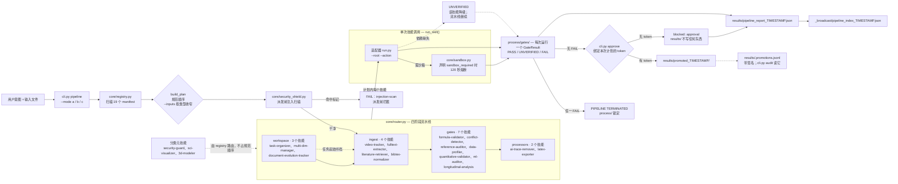

[简体中文](../README_zh.md) · [English](ARCHITECTURE.md)

# 架构

`core/router.py` 如何把一个请求变成一次有计划、有门禁的运行。README 里只留两句话，
这一页是 agent 照着实现的完整契约。

## 架构与流水线

`core/router.py` 是微内核：它读取 19 个 `manifest.json`，按规范阶段顺序生成计划，在派发任何技能**之前**先对文本输入做提示注入扫描，然后逐个调用技能的适配器。每次调用都会在 `process/gates/` 写下一个 `GateResult`——`PASS`、`UNVERIFIED` 或 `FAIL`。

缺依赖时只把该技能降级为 `UNVERIFIED`，流水线继续。单个 `FAIL` 是终止态：流水线当场停止，中间产物锁在 `process/` 里。没有任何门禁失败**且人类已针对这次计划签发审批**时，`process/` 才会被提升到 `results/`；无论是否提升，都会写出类型化的流水线报告和 `_broadcast/` 索引——后续会话先读索引，再决定打开哪些原件。

图里刻意说明的四件事：

- **自动流水线是 `ingest → gates → processors`。** `workspace`（task-organizer）是任务开始时的书挡，在流水线之前或通过 `--selected` 进入；`--mode a` 不会自动调度它。
- **`UNVERIFIED` 不是失败。** 它表示该技能无法给出判定——缺可选依赖、调用方还没提供输入——其余流程照常继续。
- **只有 `FAIL` 是终止态。** 它把 `process/` 原样锁在中断处，中间产物可审计，但不会被误当成结果。
- **提升是唯一不可逆的一步，所以由人授权。** `promote()` 需要一条针对本次计划的 token（action、工作区、模式/选择、每个输入文件的哈希、15 分钟有效期、HMAC 签名），并记入 `results/.promotions.jsonl`。这道锁跨运行有效：只要某个技能最新的一份门禁是 `FAIL`，即使当前计划没有调度它，提升也会被拒绝。`python cli.py audit` 把 `results/` 里没有对应提升记录的文件点名，并以退出码 1 结束。

---
